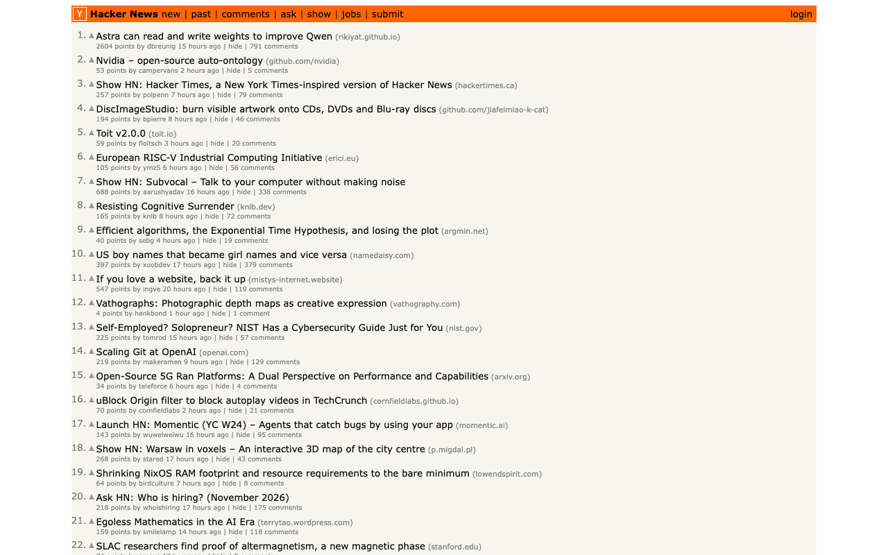
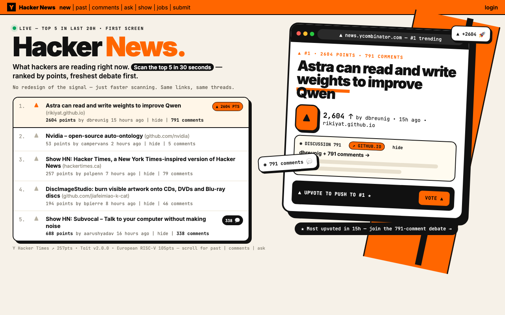
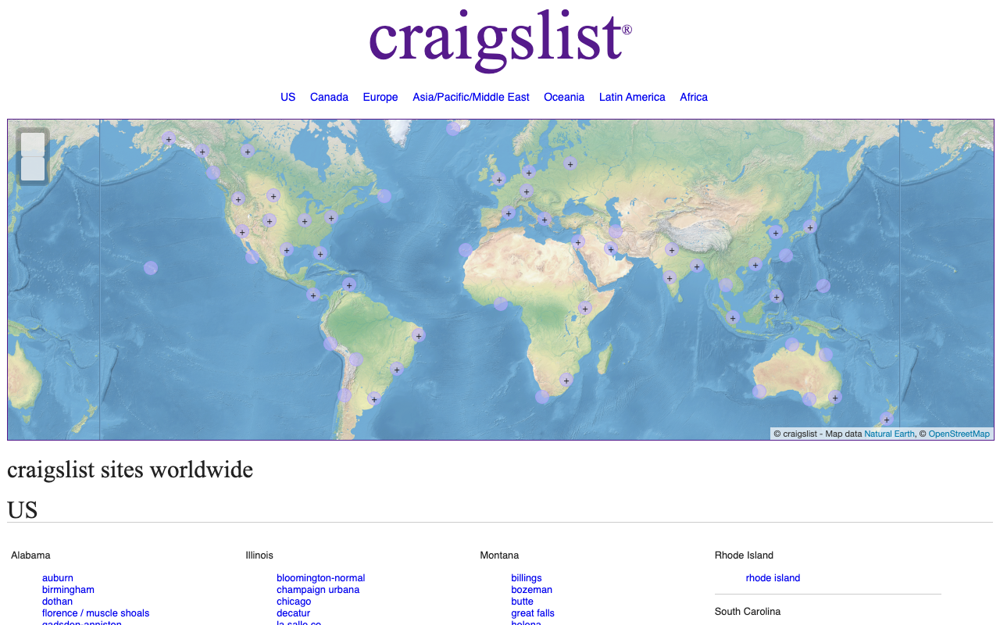
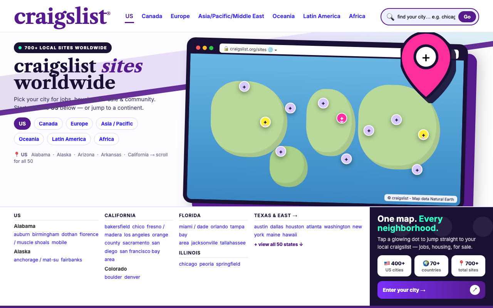
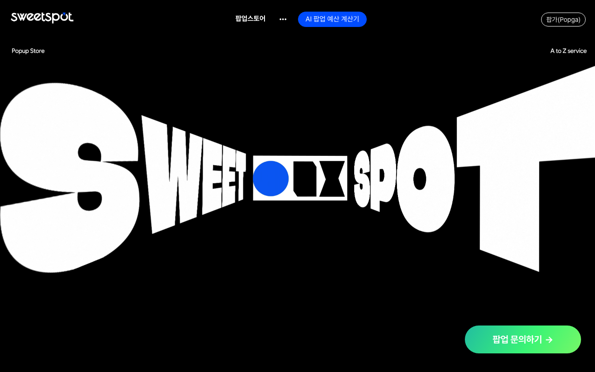
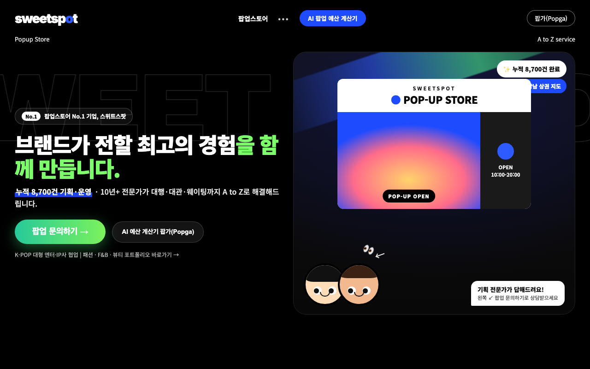

<div align="center">

# NeuroMuse

**An AI that looks before it speaks.**

A model of the human cortex (Meta TRIBE v2) sits in front of the language model, so every opinion about a photo, a clip, a line of copy or a sound comes with the brain regions and numbers behind it, and the agent learns your taste as rules you can read.

[Quick start](#quick-start) · [What it does](#what-it-does) · [Results](#results) · [Architecture](#architecture) · [Showcase](docs/SHOWCASE.md) · [Working log](docs/LOG.md) · [Demo storyline](docs/demo_storyline.md)

Meta Global AI Developer Hackathon 2026 · Indie track


<sub>Glasses mode, as recorded (the wait for the GPU is cut). A landscape first-person frame like the Meta glasses; the phone turns sideways and stands in for them. "What do you think?" of a mall pop-up: the answer names the regions that fired, quotes the percentiles, and says what is faint. <a href="docs/video/glasses.mp4">mp4</a></sub>

</div>

> Built with the **Meta Model API** (Muse Spark 1.3, tool calling), **TRIBE v2** (open weights, on Modal), the **CopilotKit** agent runtime, and the **Wearables Device Access Toolkit** glasses flow.

## Why

Ask any assistant "what do you think of this photo?" and it says "looks great". It never looked, and it cannot say why. People who make visual decisions for a living, popup-store owners, marketers, creators, want an opinion that can say *why*, admit when it does not know, and learn what *they* like. NeuroMuse answers from a predicted human cortex instead of improvising: the response is a measurement first, words second.

## What it does

<table>
<tr>
<td width="50%" align="center"></td>
<td width="50%" align="center"></td>
</tr>
<tr>
<td align="center"><sub>In the chat: attach a photo, the cortex lights up, the heads score it, the brain answers. <a href="docs/video/chat.mp4">mp4</a></sub></td>
<td align="center"><sub>In the Lab: score a stimulus, tap Like, watch memory being written and your head refit. <a href="docs/video/lab.mp4">mp4</a></sub></td>
</tr>
</table>

<table>
<tr>
<td width="25%"></td>
<td width="25%"></td>
<td width="25%"></td>
<td width="25%"></td>
</tr>
<tr>
<td><b>The brain lights up first.</b> TRIBE v2's per-vertex prediction plays on the fsaverage5 cortex inside a bust, second by second, red where the cortex responds.</td>
<td><b>Then the numbers.</b> Four calibrated heads with crowd score, confidence and percentile, the regions that drove each one, and the 1 Hz response per region.</td>
<td><b>It learns you, in front of you.</b> Every like or dislike is written to memory while you watch: trace stored, outcome written, your head refit against the crowd head. Sleep turns answers into rules in plain English; a reflex fires on anything seen before.</td>
<td><b>Honest about itself.</b> Every score carries a confidence, and the About tab shows the AUROCs and the latency we actually measured.</td>
</tr>
</table>

The agent speaks as its own brain, in the first person: *"My early visual cortex lit up in the top 12%, which means the colour contrast is doing real work. But my reward circuit stayed quiet: pleasing to look at, not something I'd want to own."* Ask "why?" and it cites percentiles and regions in everyday words. Raw area codes never reach the user; raw brain vectors never reach the language model.

## Features

- **Looks before it speaks.** Photos, clips, text and audio go through Meta's TRIBE v2 first; the opinion is a measurement of a predicted human cortex (20,484 vertices, 1 Hz), words second.
- **Six calibrated heads, each with a confidence.** Aesthetic appeal, Attention capture, Desirability, Reach, Human-likeness (text), Hook (audio), trained on real outcomes: AADB ratings, SnapUGC watch retention, Unsplash downloads and views, HC3 human-vs-model text. Below 0.3 confidence the agent says "I'm not sure".
- **Live 3D cortex in the chat.** The fsaverage5 surface inside a bust, the prediction playing per second, then bars, drivers and the per-region time course.
- **Glasses mode.** A landscape first-person frame like the Meta glasses: rolling 6-second clip, "Hey Meta"-style voice in, spoken captions out; a phone stands in for the glasses over HTTPS, and the Mock Device Kit path is the same flow.
- **Memory you can read.** Every percept is stored as a cortex state with its outcome; sleep refits a personal head, mines area-contrast rules with bootstrap confidence intervals and writes them as plain English; recall cites precedents above 0.9 similarity; a one-line reflex answers without a reasoning pass. The Lab shows every write as it happens.
- **One signal judges and steers.** The same brain score is the reward of design loops: live-site redesigns, landing pages, 12-second ad clips, Blender rooms, a curated shop, writing.
- **Writing and voice through the same brain.** A Human-likeness head and a cortex critique of what the reader misses; the draft and the rewrite read aloud through the audio pathway.
- **Honest numbers.** Ablations, holdout AUROCs, latency, the judge's verdicts including the losses, all in the repo.

## Results

Real sites first. The agent keeps brand, copy and information architecture, reads the predicted cortex of a viewer, and redesigns until the attention and aesthetic heads move. Scores are `ui_score` (0.6 · aesthetic + 0.4 · attention, shrunk by confidence); every pair is also judged blind, both orders, by a Muse judge that wrote neither side. [All pairs, tables and caveats →](docs/SHOWCASE.md)

<table>
<tr><th width="50%">Live site</th><th width="50%">Brain-guided redesign</th></tr>
<tr>
<td></td>
<td></td>
</tr>
<tr><td colspan="2" align="center"><sub>Hacker News, same links and threads. The cortex said the list gives the eye nothing to land on; the redesign keeps the orange, adds one hero story and a scannable top five. ui_score 0.445 → 0.584.</sub></td></tr>
<tr>
<td></td>
<td></td>
</tr>
<tr><td colspan="2" align="center"><sub>craigslist, brand and copy kept. The brain asked for an object silhouette and something to hold attention after two seconds. ui_score 0.473 → 0.594.</sub></td></tr>
<tr>
<td></td>
<td></td>
</tr>
<tr><td colspan="2" align="center"><sub>Our own site. The reward circuit was quiet on the live page; the redesign puts the offer, the proof (8,700 pop-ups) and the call in the first screen. ui_score 0.663 → 0.740.</sub></td></tr>
<tr>
<td></td>
<td></td>
</tr>
<tr><td colspan="2"></td></tr>
<tr><td colspan="2" align="center"><sub>Video: a 12-second ad clip generated by Muse once (left) and with the cortex critiquing each round (right), and the predicted cortex of a viewer second by second. The one-shot ad grabs attention for a second and loses it; the brain-loop ad was told the hook was too slow and builds instead. Blind judge P = 0.92.</sub></td></tr>
<tr>
<td></td>
<td></td>
</tr>
<tr><td colspan="2" align="center"><sub>3D: a photoreal Blender room, re-rendered each round from the cortex critique (0.316 → 0.485, <a href="results/showcase/studio/living5/timelapse.gif">timelapse</a>).</sub></td></tr>
<tr>
<td></td>
<td></td>
</tr>
<tr><td colspan="2" align="center"><sub>Same brief, both sides written by Muse: ask once (left) vs the cortex critiquing each round (right). Blind judge P(brain better) = 0.90; the human vote agreed.</sub></td></tr>
<tr><td colspan="2"></td></tr>
<tr><td colspan="2" align="center"><sub>Writing: a Human-likeness head (holdout AUROC 0.88) and a critique of what the reader's cortex misses. The rewrite wins the blind judge at 0.90. The head alone can be gamed, so the brain is the critic, never the only judge: <a href="docs/SHOWCASE.md#writing-and-voice-through-the-same-brain">details</a>.</sub></td></tr>
</table>

Writing, all five tasks (chatbot draft → Muse asked once to "make it human" → brain in the loop; percentiles from the Human-likeness head, judge = blind pairwise Muse):

| task | Human-likeness pct: draft → one-shot → brain | Attention pct: draft → brain | judge P(brain > one-shot) | judge P(brain > draft) |
|---|---|---|---|---|
| customer-support reply | 26 → 4 → **31** | 75 → 86 | **0.83** | **0.90** |
| founder's LinkedIn post | 4 → 5 → **13** | 90 → 93 | **0.88** | **0.90** |
| pop-up Instagram caption | 51 → 37 → **76** | 35 → 54 | 0.12 | 0.10 |
| cold email | 8 → 4 → **14** | 86 → 77 | 0.10 | 0.12 |
| dating-app bio | 98 → 98 → 99 | 70 → 65 | 0.05 | 0.05 |

Two of five by the judge when the loop chases the head alone; with Muse's own review as a gate it is two wins, one tie, one loss. A text can score "human" by sounding hesitant, so in the product the brain is the critic and never the only judge. On fresh page briefs where Muse writes both sides, the one-shot is already strong: the loop wins 3 of 5 pages (+1 tie) and 3 of 3 clips by the judge, and loses to Muse's own self-critique loop by Muse's own judge. Every number, including the losses, is in [docs/SHOWCASE.md](docs/SHOWCASE.md).


## Use cases

<table>
<tr>
<td width="25%"><b>In a store, through the glasses.</b> Point at a shelf, ask "what do you think?", hear a grounded answer with the region that fired.</td>
<td width="25%"><b>Copy that reads human.</b> Paste a paragraph; the Human-likeness head (0.88 AUROC) and a rewrite loop turn "Our popup store offers a unique experience…" into something a person would write, with before → after percentiles.</td>
<td width="25%"><b>Ads and pages that hold attention.</b> Brain-in-the-loop generation and live-site redesign, with the 1 Hz attention course as the critique.</td>
<td width="25%"><b>Your own taste, on record.</b> Like and dislike in the Lab; read the rules it learned, watch your head overtake the crowd head, reset any time.</td>
</tr>
</table>

## Architecture


1. **The brain comes before the language model.** V-JEPA2, DINOv2, wav2vec-BERT and Llama 3.2 embed video, audio and text; TRIBE v2 predicts 20,484 cortical vertices at 1 Hz. That is Meta's open model; everything downstream is ours.
2. **Heads, not vibes.** 360 area means → PCA-54 → logistic heads calibrated on real outcomes (AADB ratings, SnapUGC retention, Unsplash downloads, HC3 human-vs-model text), each with a confidence the agent must respect.
3. **The language model only sees head outputs**, through tools (`brain_eval`, `look_at`, `brain_recall`, `brain_rules`), and says "I'm not sure" below 0.3 confidence.
4. **One signal judges and steers.** The score that rates a photo is the reward of a design loop: pages, ad clips, live sites, Blender rooms, writing.
5. **Memory in brain-state space.** Every percept is a cortex state with its outcome; sleep refits a personal head and mines rules with bootstrap confidence intervals; recall cites precedents; a reflex answers in one line.
6. **It already behaves like glasses.** A rolling 6-second clip, `look_at` sees what it is, `brain_eval` measures it, the answer comes back spoken. 14 s per clip on a Modal L40S.

## Numbers

| what | result |
|---|---|
| AADB aesthetics, 2,500 photos, 5-fold AUROC | 9 regions pooled 0.669 · raw V-JEPA2 0.728 · **360 areas → PCA-54 0.753** |
| Shipped heads, holdout AUROC | aesthetic appeal 0.72 · attention capture 0.65 · desirability 0.58 · reach 0.59 · human-likeness (text) **0.88** |
| Latency, one never-seen 6 s clip, L40S | 43 s → **14 s**; 4 s per cached clip |
| Brain loop vs one shot, blind pairwise judge | pages 3/5 + 1 tie · 12 s ad clips **3/3** · writing 2/5 (head only), 2 wins 1 tie 1 loss (head + review) |
| Brain-guided redesign of live sites | 3 of 4 improved (ui_score +0.08 to +0.14); the fourth kept the live page |
| Personal head after 12 synthetic outcomes | LOO AUROC 0.56 vs crowd 0.67, i.e. no personal signal yet at n = 12 (reported as is) |
| Text pathway, Human-likeness head by domain | finance 0.91 · medicine 0.95 · open-QA 0.89 · Reddit ELI5 0.91 · Wikipedia-CS 0.75 (n = 230, ECE 0.077) |

The brain buys explanation more than accuracy: at matched width the cortex features land beside the raw embedding, and every call names the areas behind it. TRIBE v2 predicts an average viewer, so the heads, not the brain, make the opinion. The full log of what worked and what did not is in [docs/LOG.md](docs/LOG.md).

## Quick start

```bash
uv run uvicorn brainsense.agent.server:app --port 8000      # brain server: heads, TRIBE proxy, memory, assets
cd app && pnpm install && OPENAI_API_KEY=<Meta Model API key> CPK_INTELLIGENCE_API_KEY=dummy-local RICH_THREADS=false BRAINSENSE_URL=http://127.0.0.1:8000 pnpm dev
pnpm --dir app/apps/mobile web                              # http://localhost:8081
node app/scripts/lan-https.mjs                              # phone: https://<laptop-ip>:8443 → glasses mode with the live camera
```

The TRIBE v2 service runs on Modal (`modal deploy brainsense/tribe/modal_app.py`); set `BRAINSENSE_TRIBE_URL`, `BRAINSENSE_LLM_BASE_URL` and `BRAINSENSE_LLM_API_KEY` in `.env`.

## Repository layout

| path | what |
|---|---|
| `brainsense/agent/` | the brain server: heads, TRIBE proxy, Engram memory, sleep, rules, reflex, skills, `/assets` |
| `brainsense/tribe/` | the TRIBE v2 service on Modal (video, audio and text events, per-area features, per-vertex time series) |
| `brainsense/loop/`, `brainsense/showcase/` | design loops and the showcase harness: pages, ad clips, live-site redesigns, Blender studio, writing |
| `heads/`, `scripts/` | trained heads and the data → features → heads scripts |
| `app/` | the client: React Native + Expo app and the Hono agent server with the brain tools ([app/README.md](app/README.md)) |
| `results/` | every run: ablations, showcase pairs, latency, votes |
| `docs/` | [SHOWCASE.md](docs/SHOWCASE.md) (every pair with numbers), [LOG.md](docs/LOG.md) (the working log), [demo_storyline.md](docs/demo_storyline.md), figures, screenshots, videos |

## Credits and licenses

TRIBE v2 (Meta, open weights) · head bust from the Meta TRIBE v2 demo (non-commercial use) · brain mesh fsaverage5 (FreeSurfer) · the app runtime is built on CopilotKit's MIT-licensed OpenMuse agent app (`app/LICENSE`) · sample photos are Creative Commons (`app/apps/mobile/assets/CREDITS.md`) · Blender studio assets Poly Haven CC0.
