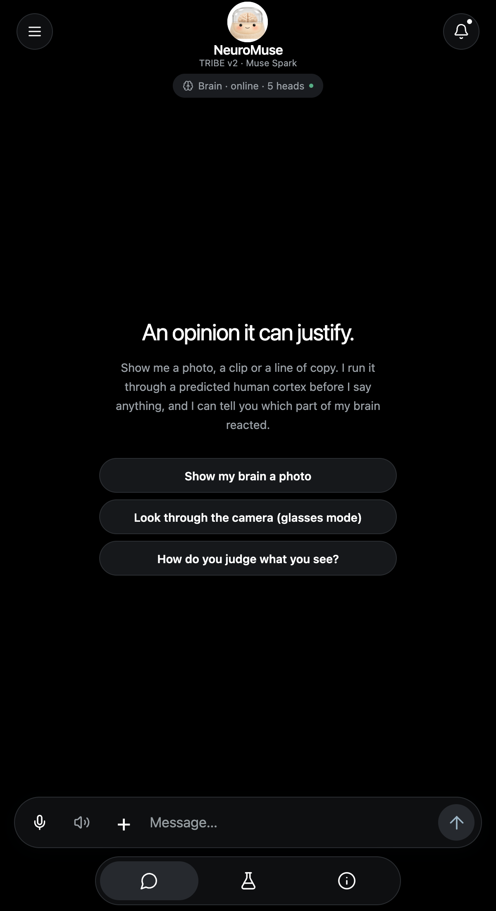
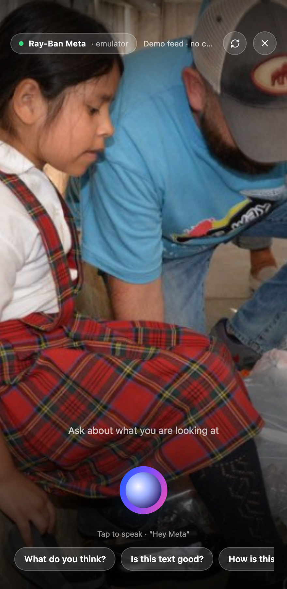
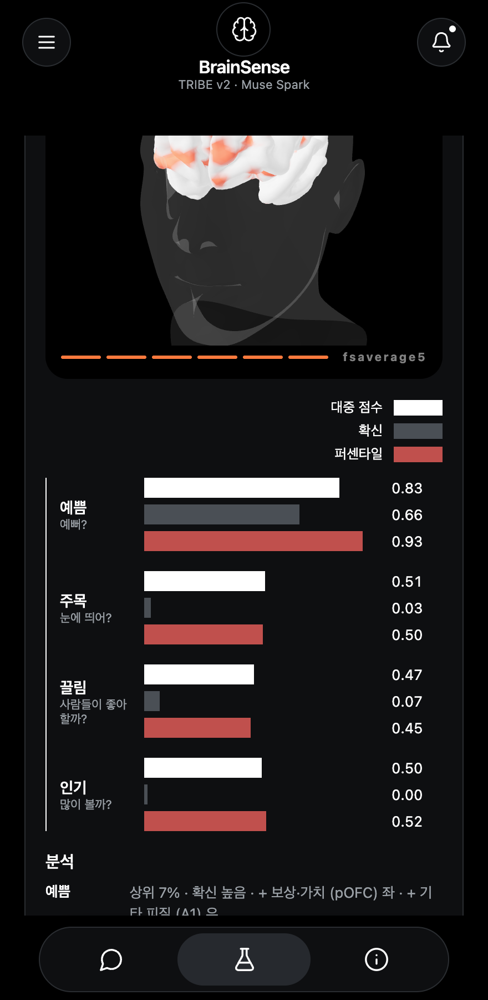
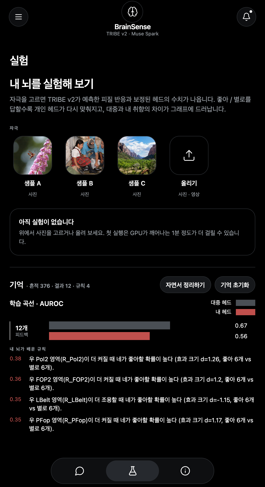
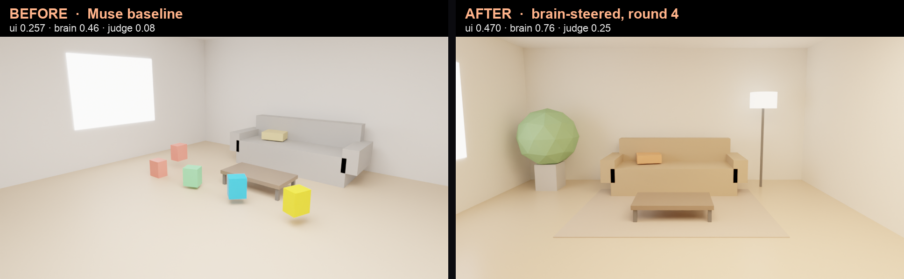
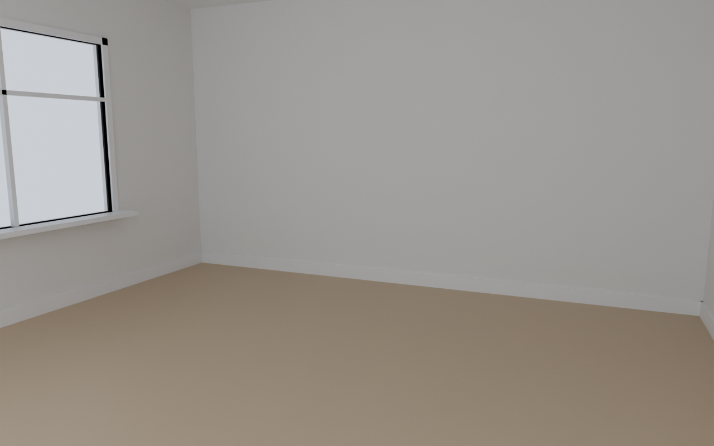
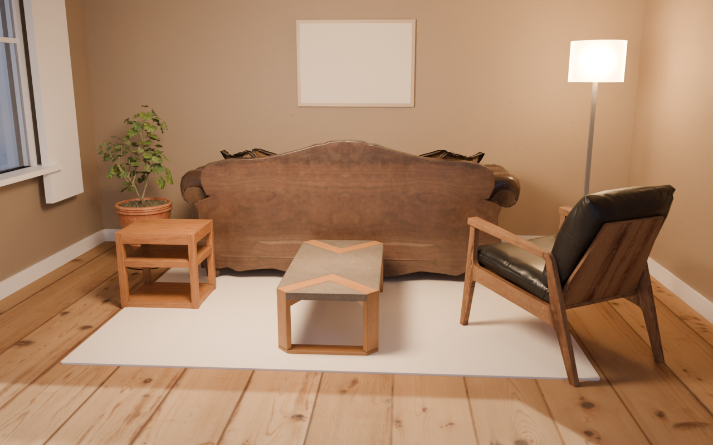
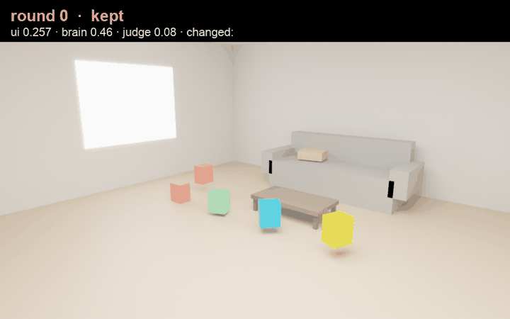

<div align="center">

# NeuroMuse

**An AI that looks before it speaks.** A model of the human brain (Meta TRIBE v2) sits in front of the language model, so every opinion about a photo, a clip, a line of copy or a sound comes with the brain regions and numbers behind it, and the agent learns your taste as rules you can read.

Meta Global AI Developer Hackathon 2026 · Indie track · built on **Meta Model API (Muse Spark 1.3)** · **TRIBE v2** (open weights) · **OpenMuse / CopilotKit** · **Modal** · the **Wearables Device Access Toolkit** glasses flow

<table>
<tr>
<td width="34%"></td>
<td width="33%"></td>
<td width="33%"></td>
</tr>
<tr>
<td align="center"><sub>Chat home</sub></td>
<td align="center"><sub>Glasses mode (phone as Ray-Ban Meta)</sub></td>
<td align="center"><sub>The brain card: cortex, then numbers</sub></td>
</tr>
</table>

</div>

## Why

Ask any assistant "what do you think of this photo?" and it says "looks great". It never looked, and it cannot say why. People who make visual decisions for a living, popup-store owners, marketers, creators, want an opinion that can say *why*, admit when it does not know, and learn what *they* like. NeuroMuse answers from a predicted human cortex instead of improvising: the response is a measurement first, words second.

## What it feels like

<table>
<tr>
<td width="25%"></td>
<td width="25%"></td>
<td width="25%"></td>
<td width="25%"></td>
</tr>
<tr>
<td><b>The brain lights up first.</b> TRIBE v2's per-vertex prediction plays on the fsaverage5 cortex inside a bust, second by second, red where the cortex responds.</td>
<td><b>Then the numbers.</b> Four calibrated heads with crowd score, confidence and percentile, the regions that drove each one, and the 1 Hz response per region.</td>
<td><b>It learns you.</b> Like / dislike → sleep → rules in plain English, a crowd-vs-you learning curve, and a one-line reflex on anything it has seen before.</td>
<td><b>Honest about itself.</b> Every score carries a confidence, and the About tab shows the AUROCs and the latency we actually measured.</td>
</tr>
</table>

In the chat the agent speaks as its own brain, in the first person: *"My early visual cortex lit up in the top 12%, which means the colour contrast is doing real work. But my reward circuit stayed quiet: pleasing to look at, not something I'd want to own."* Ask "why?" and it cites percentiles and regions in everyday words; raw area codes never reach the user, and raw brain vectors never reach the LLM.

## Plain AI vs a brain in the loop

Same brief, same Muse Spark, same budget. Only the feedback differs: the left column asked the model once; the right column let the predicted cortex critique each round.

<table>
<tr><th width="50%">Muse Spark, one shot</th><th width="50%">Brain in the loop</th></tr>
<tr>
<td></td>
<td></td>
</tr>
<tr><td colspan="2" align="center"><sub>Skincare ad page. Blind pairwise verdict P(brain better) = 0.90; the human vote picked the brain one too.</sub></td></tr>
<tr>
<td></td>
<td></td>
</tr>
<tr><td colspan="2" align="center"><sub>12-second ad clip, frames at 1 / 5 / 9 s. On video the brain loop wins every pairwise verdict (P ≥ 0.85): the critique reads the cortex <em>time course</em> (hook, hold, call to action) that a screenshot judge never sees.</sub></td></tr>
<tr>
<td></td>
<td></td>
</tr>
<tr><td colspan="2" align="center"><sub>A live site, brand and copy kept. The brain asked for an object silhouette and something to hold attention after two seconds; ui_score 0.473 → 0.594.</sub></td></tr>
<tr>
<td colspan="2"></td>
</tr>
<tr><td colspan="2" align="center"><sub>Not only pages: a parametric Blender room, re-rendered each round from the cortex critique, 0.257 → 0.470 in six rounds (<a href="results/showcase/interior/room3/timelapse.gif">timelapse</a>).</sub></td></tr>
<tr>
<td></td>
<td></td>
</tr>
<tr><td colspan="2" align="center"><sub>The same loop with a photoreal Blender studio (Poly Haven assets): the agent places furniture, textures and light from a JSON spec, renders, reads the cortex, and keeps the round the brain liked most.</sub></td></tr>
</table>

Caveat we keep next to every win rate: on static pages, against Muse's *own* self-critique loop, the brain loop loses by Muse's own judge (which that loop optimises directly). Against "ask once" it wins on pages, and on video it wins against both. Full tables and the blind human-vote page are in the showcase section below.

## Architecture


What is different about it:

1. **The brain comes before the language model.** Video, audio and text are embedded by V-JEPA2, DINOv2, wav2vec-BERT and Llama 3.2; TRIBE v2 predicts the 1 Hz response of 20,484 cortical vertices. That is Meta's open model. Everything downstream is ours.
2. **Heads, not vibes.** 360 cortical-area means → PCA-54 → logistic heads calibrated on real outcomes (AADB ratings, SnapUGC watch retention, Unsplash downloads and views, HC3 human-vs-model text), each with a temperature-scaled confidence the agent must respect. Pooling the cortex into 9 regions lost accuracy; per-area features recovered it (0.67 → 0.75 AUROC).
3. **The LLM only ever sees head outputs.** Muse Spark gets percentiles, confidence and named regions through tools (`brain_eval`, `look_at`, `brain_recall`, `brain_rules`, skills) and is told to say "I'm not sure" below 0.3 confidence. It cannot rate without a measurement.
4. **One signal judges and steers.** The same brain score that rates a photo is the reward of a design loop: landing pages, 12-second ads, live-site redesigns, a Blender room, a curated shop. Renders go back in as input, round after round.
5. **Memory in brain-state space.** Every percept is stored as a cortex state with its outcome; sleep refits a personal head, mines area-contrast rules with bootstrap CIs and writes them as falsifiable English sentences; recall cites precedents above 0.9 similarity; a reflex answers in one line without a reasoning pass.
6. **It already behaves like glasses.** A phone (or the Mock Device Kit path) keeps a rolling 6-second clip; "What do you think?" uploads it, `look_at` sees what it is, `brain_eval` measures it, the answer comes back as spoken captions. 14 s per clip on a Modal L40S.

## Numbers we measured

| what | result |
|---|---|
| AADB aesthetics, 2,500 photos, 5-fold AUROC | 9 regions pooled 0.669 · raw V-JEPA2 0.728 · raw PCA-54 0.722 · **360 areas → PCA-54 0.753** |
| Shipped heads, holdout AUROC | aesthetic appeal 0.72 · attention capture 0.65 · desirability 0.58 · reach 0.59 · human-likeness (text) **0.88** |
| Latency, one never-seen 6 s clip, L40S | 43 s → **14 s** (no transcription for silent clips + bf16); 4 s per cached clip |
| Brain loop vs one-shot, blind pairwise Muse judge | pages 3/5 wins + 1 tie (P 0.64) · 12 s ad clips **3/3** (P 0.89) |
| Brain-guided redesign of live sites | 3 of 4 improved (ui_score +0.08 to +0.14); the fourth kept the live page |
| Personal head after 12 synthetic outcomes | LOO AUROC 0.56 vs crowd 0.67, i.e. no personal signal yet at n = 12 (reported as is) |

What the brain buys is explanation more than accuracy: at matched width the cortex features land beside the raw embedding, and every call names the areas behind it. TRIBE v2 predicts an average viewer and was trained on passive viewing, so value-region predictions are weak by construction; that is why the heads, not the brain, make the opinion.

## Use cases

<table>
<tr>
<td width="25%"><b>In a store, through the glasses.</b> Point at a shelf, ask "what do you think?", hear a grounded answer with the region that fired.</td>
<td width="25%"><b>Copy that reads human.</b> Paste a paragraph; the Human-likeness head (0.88 AUROC) and a rewrite loop turn "Our popup store offers a unique experience…" into something a person would write, with before → after percentiles.</td>
<td width="25%"><b>Ads and pages that hold attention.</b> Brain-in-the-loop generation and live-site redesign, with the 1 Hz attention course as the critique.</td>
<td width="25%"><b>Your own taste, on record.</b> Like and dislike in the Lab; read the rules it learned, watch your head overtake the crowd head, reset any time.</td>
</tr>
</table>

## Run it

```bash
uv run uvicorn brainsense.agent.server:app --port 8000                         # heads, TRIBE proxy, memory, /assets
cd ../openmuse && OPENAI_API_KEY=$BRAINSENSE_LLM_API_KEY CPK_INTELLIGENCE_API_KEY=dummy-local RICH_THREADS=false BRAINSENSE_URL=http://127.0.0.1:8000 pnpm dev
pnpm --dir ../openmuse/apps/mobile web                                          # http://localhost:8081
node ../openmuse/scripts/lan-https.mjs                                         # phone: https://<laptop-ip>:8443 → glasses mode with the live camera
```

The app is a fork of [CopilotKit/OpenMuse](https://github.com/CopilotKit/openmuse): [yc9954/openmuse-brainsense](https://github.com/yc9954/openmuse-brainsense), branch `brainsense-ui`. The TRIBE service runs on Modal (`modal deploy brainsense/tribe/modal_app.py`). Everything below is the working log: measurements, decisions, what failed and why.

---

# Details

## Status (2026-10-27)
| piece | state |
|---|---|
| ROI groups + pooled features (`brainsense/tribe/rois.py`) | done, tested offline |
| TRIBE v2 Modal service + latency benchmark (`brainsense/tribe/modal_app.py`) | **running on L40S**. Honest per-clip latency on a *new* clip: events (ffmpeg+WhisperX+spaCy) ~14 s + TRIBE predict ~28 s + raw embed ~0.5 s ≈ **43 s for a 6 s still**, ~105 s for a 12 s UGC video. The 3.4 s 'warm' number in `results/latency.json` was a neuralset feature-cache hit on the same file, not real inference. Optimization is now a day-1 task (see below). |
| Heads: calibrated head, personal head, ablation CLI (`brainsense/heads/`) | **trained on real features** (`heads/`), ablation done on 3 datasets (see below) |
| Agent: tools, system prompt, OpenAI-compatible loop, FastAPI server (`brainsense/agent/`) | **live on Muse Spark 1.3** (2026-11-01): glasses clip → Modal TRIBE → heads → tool-calling agent → Korean reply citing head scores; feedback updates the personal head |
| Dataset prep (`brainsense/data/prepare.py`) | **run**: AADB 500 imgs (+6 s stills), Unsplash 300 imgs (+stills), SnapUGC 150 live videos; manifests under `data/*/manifest.csv` |
| Feature extraction (`scripts/extract_features.py`) | **done**: 947/950 items → `features/{aadb,unsplash,snapugc}.npz` |
| **App UI (OpenMuse / CopilotKit React Native)** | **done, verified in the browser** (2026-11-02): `../openmuse/apps/mobile` — "Look" tab with photo/clip picker, bundled samples, BrainCard (3 head gauges, confidence, top regions in Korean, crowd-vs-you), 1 Hz ROI sparkline, chat with quick chips and 👍👎. Runs standalone against the FastAPI server; iOS/Android via Expo (needs Xcode / Android Studio to build natively). |
| Glasses capture (SwiftUI skeleton, `app/ios/`) | DAT SDK ring buffer + TTS; superseded as the UI by the OpenMuse app, kept for the glasses capture path |
| Demo video + write-up | script in `docs/demo_script.md` |

## Ablation results (real TRIBE features; AADB updated to 2,500 images on 2026-11-02)
**Shipped aesthetic head (2026-11-03):** 360 HCP-MMP1 area means → PCA-54 → logistic, trained on the full 2,500-image AADB area-feature store (`features/aadb_area.npz`, `heads_area2500/`): holdout AUROC **0.721**, ECE 0.041 (temperature 1.30), n_train 1,492. The 600-image version scored 0.718 on its smaller holdout; the extra data mostly buys calibration, not accuracy, which is consistent with the ablation below.

Linear heads, AUROC on a fixed 25% test split, mean over seeds. `raw_pca54` compresses the raw V-JEPA2 embedding to the same width as the brain features (the fair control).

| dataset (label) | n_train | TRIBE ROI (54-d) | raw V-JEPA2 (1408-d) | raw PCA-54 |
|---|---|---|---|---|
| AADB (human aesthetic rating, median split) | 100 | 0.61 | 0.65 | 0.62 |
| | 400 | 0.67 | 0.69 | 0.70 |
| | 1,875 | 0.69 | 0.69 | **0.73** |
| AADB, one split, more controls | 1,875 | 0.69 | — | PCA-54 0.73 · **hybrid (TRIBE + PCA-54) 0.75** · PCA-108 0.76 |
| Unsplash (log downloads/views), 1,500 items | 1,125 | 0.57 | 0.55 | 0.58 |
| Unsplash (log views, median split) → `popularity` head | 1,125 | **0.60** | 0.55 | 0.59 |
| SnapUGC (ECR watch retention), 587 videos | 440 | **0.62** | 0.66 | 0.60 |

Reading: aesthetics is learnable (0.69–0.76). With enough data the brain bottleneck **saturates below** a width-matched PCA of the raw embedding (0.69 vs 0.73), i.e. pooling predicted cortex into 9 regions discards information the embedding keeps; adding the brain features on top of PCA still helps a little (0.75 vs 0.73). So the honest claim is: **the brain prior buys interpretability, not accuracy**; the shipped `aesthetic` head is the TRIBE 54-d one because every chip it shows ("▲ 보상·가치 후반") is a real coefficient on a named region. A hybrid head is the obvious next step if accuracy matters more than explanation. **Richer brain features:** the service now also returns per-area means and slopes for all 360 HCP-MMP1 areas (720-d, `roi_area_feats`), to test whether the information loss is the 9-group pooling rather than the brain prior itself Result on 600 AADB images, 5-fold CV, linear heads:

| features | AUROC |
|---|---|
| TRIBE 9 groups × 6 stats (54-d, shipped so far) | 0.669 |
| TRIBE 360 area means (360-d) | 0.708 |
| TRIBE 360 areas mean+slope (720-d) | 0.711 |
| **TRIBE area means → PCA-54** | **0.753** |
| raw V-JEPA2 (1408-d) | 0.728 |
| raw → PCA-54 | 0.722 |
| raw → PCA-108 | 0.717 |

So the loss was the pooling: per-area brain features compressed to 54 dims **beat the raw embedding** at the same width and even the full embedding. The brain prior earns accuracy *and* interpretability once we stop averaging 180 areas into 9 buckets. Confirmation on all 2,500 images is paused at 600/2,500 (Modal usage limit reached); the heads are being switched to area-PCA features with contributions back-projected to named areas. With 4× more data, watch retention became learnable (0.62 brain / 0.66 raw) and here the 9-region brain features beat the width-matched PCA (0.62 vs 0.60), consistent with attention-related cortex carrying temporal information a static embedding pools away. Downloads-per-view stays weak (0.57–0.58). Heads are calibrated, so the agent's confidence tracks these numbers.

Trained heads (`heads/`, 2026-11-02): aesthetic AUROC 0.67 / ECE 0.03 (n=1,492); attention 0.65 / ECE 0.06 (n=365); appeal 0.58 / ECE 0.04 (n=910); popularity 0.59 / ECE 0.05 (n=910). (Unsplash Lite's `featured` flag was tried as an editorial-quality label and dropped: 98% positive.) Feature stores: 4,587 items across the three datasets.

The numbers in `results/ablation_synthetic/` are from synthetic data and only prove the CLI works.

## Run
```bash
uv sync                                   # local (Mac) deps; GPU deps live in the Modal image
uv run python -m pytest -q                # offline end-to-end smoke test (no GPU/network)

# 1. TRIBE latency (the day-1 number everything depends on)
uv run modal setup                        # browser login, once
uv run modal secret create huggingface HF_TOKEN=hf_...   # accept meta-llama/Llama-3.2-3B license first
uv run modal run brainsense/tribe/modal_app.py::main --video samples/test_clip.mp4 --repeats 3
#   → results/latency.json ; first call includes ~15 GB weight download into the Volume

# 2. Data → features → heads
# (already done for a first subset — rerun with bigger --n when the TRIBE pipeline is confirmed)
uv run python -m brainsense.data.prepare unsplash --n 1500      # appeal: log(downloads/views)
uv run python -m brainsense.data.prepare aadb --n 2000          # aesthetic: AADBinfo.mat + HF zip (2.5 GB, curl resume)
uv run python -m brainsense.data.prepare snapugc --n 1500       # attention: ECR; ~17% of CDN links live
uv run python -m brainsense.data.prepare stills                 # images → 6 s silent clips for TRIBE
uv run modal run scripts/extract_features.py::extract --manifest data/unsplash/manifest.csv --out features/unsplash.npz
uv run python -m brainsense.heads.ablation features/unsplash.npz --out results/ablation_unsplash
PYTHONPATH=. uv run python scripts/train_heads.py --appeal features/unsplash.npz --aesthetic features/aadb.npz

# 3. Agent server (the phone app talks only to this)
export BRAINSENSE_LLM_BASE_URL=https://api.meta.ai/v1 BRAINSENSE_LLM_API_KEY=$MODEL_API_KEY BRAINSENSE_LLM_MODEL=muse-spark-1.3
export BRAINSENSE_TRIBE_URL=https://alexyc0506--brainsense-tribe-tribe-http.us-east.modal.run   # deployed 2026-10-30
uv run uvicorn brainsense.agent.server:app --port 8000               # POST /analyze, /agent, /agent/feedback
```

## Things only you can do (in order)
0. **Create a Meta Model API key** at dev.meta.ai → API keys and put it in `.env` as `BRAINSENSE_LLM_API_KEY=...` (then remove `BRAINSENSE_LLM_MOCK=1`). Everything else below is done.
1. ~~`uv run modal setup`~~ (done 2026-10-28). **Add a payment method on modal.com → Settings → Billing**: every GPU type (L40S, A10G tried) refuses to start without one, even on free credits. Then claim the Modal $100 hackathon credit (first 1,000). The image itself builds fine (all layers verified).
   (2026-10-30: Modal card done, weights prefetched via `modal run brainsense/tribe/modal_app.py::prefetch`, Llama access requested on HF.) Create the `huggingface` secret with a *real* token (`modal secret create --force huggingface HF_TOKEN=hf_...`) after accepting the Llama-3.2-3B license; the placeholder value currently stored will fail the Llama download.
2. Claim the $150 Model API credit via the participant-guide form (needs a card on file) and set a spend limit.
3. Try creating a Wearables Developer Center org from Korea (work.meta.com → Managed Meta Account). If blocked, go Mock Device Kit (spec has the fallback).
4. Create a Tianchi account for CreativeRanking and submit the Visuelle 2.0 form (hedges for the appeal head).
5. Track decided: **Indie** (submitted on the Modal credit form). Repo: https://github.com/yc9954/brainsense (private; run `gh repo edit yc9954/brainsense --visibility public --accept-visibility-change-consequences` right before submitting, the rules require a public repo).
6. Record the 3-minute demo video (`docs/demo_script.md`; the web build at :8081 with the sample photos is enough, or the phone with Mock Device Kit), build the iOS app in Xcode (`app/ios/README.md`), submit on the Cerebral Valley portal by **Nov 4 9:00 PM ET / Nov 5 11:00 KST** with `docs/submission.md` as the write-up. Also make https://github.com/yc9954/openmuse-brainsense public, and rotate the Modal and Hugging Face tokens that were pasted into chat.
7. Optional: a real CopilotKit Intelligence key (`npx copilotkit@latest login`) gives durable threads; without it the local stub runs everything in memory, which is fine for the demo.

## Live transcript (real Muse Spark, real TRIBE features, 2026-11-01)
```
Q: 이거 어때?
A: 잘 모르겠어 지금은 판단하기 애매해. 신호가 너무 약하게 잡혀서 대중 예측도 중간 정도에서 흔들리고 있어. 좋아 별로 알려주면 네 취향 맞춰갈게.
Q: 왜 그렇게 생각해?
A: 결론은 그대로 잘 모르겠어. 대중 매력 점수가 0.53에 상위 65퍼센트로 딱 중간인데 신뢰도가 0.05밖에 안 되고 시각 주의랑 언어 신호가 엇갈려서야. ...
Q: 음 난 별로야
A: 오케이 별로로 저장했어 다음부터 네 취향 반영해서 더 잘 맞춰줄게
```
Grounding works as designed: the number it quotes (0.53 / 상위 65% / 신뢰도 0.05) is the `appeal` head output, and it declines to opine when confidence is low. Note: Muse counts reasoning tokens against `max_tokens`; the loop uses 1024 and never stores an empty assistant turn.

## App UI (OpenMuse)
**Look (2026-11-03):** the whole app is restyled in the visual language of Meta's TRIBE v2 site: black canvas, white type, two greys and one red for data, thin outlined cards and icon tiles, no mascot, no emoji. Three tabs only: **대화** (the OpenMuse chat with glasses mode inside), **실험** (a brain lab: pick a stimulus, run TRIBE + heads, answer 좋아/별로 to refit the personal head and watch crowd-vs-you move) and **소개** (what it is, the pipeline figure, measured numbers, limits). The brain card shows its numbers as the site's bar chart (score / confidence / percentile per head) with a written analysis line per head (driver areas as + / −) and the server's critique when present.

The UI *is* [CopilotKit/OpenMuse](https://github.com/CopilotKit/openmuse) (React Native + Expo + Hono, MIT), cloned to `../openmuse` with its chat home, sidebar, thinking process, activity/ideas/goals/apps tabs untouched. BrainSense is not a tab: it is a server tool the agent reaches for mid-conversation plus a prompt that makes the agent speak as its own brain (see below).
```bash
# 1. agent server (this repo): heads, TRIBE proxy, /assets/fsaverage5_pial.bin for the 3D cortex
uv run uvicorn brainsense.agent.server:app --port 8000
# 2. OpenMuse server on the Meta Model API (no CopilotKit key needed: a local in-memory Intelligence stub + SSE runtime)
cd ../openmuse && OPENAI_API_KEY=$BRAINSENSE_LLM_API_KEY CPK_INTELLIGENCE_API_KEY=dummy-local RICH_THREADS=false BRAINSENSE_URL=http://127.0.0.1:8000 pnpm dev
# 3. web UI
pnpm --dir ../openmuse/apps/mobile web          # http://localhost:8081
```
Live-demo caveat: the deployed TRIBE endpoint shares the workspace's 10-GPU cap with batch extraction; pause batch jobs before a demo. Modal web endpoints 303-redirect after 150 s; the server follows them. A fresh container needs ~70 s to load the model; `BRAINSENSE_WARM=1 modal deploy` keeps one resident during a demo (~$2/h).

**Judged loop run `judged3` (2026-11-03, 2 rounds × 3 variants, parallel):** round 2 best ui_score 0.654 vs round 1 best 0.603 (brain heads + Muse judge, 50/50). The judge's recurring critique (illustration placeholders instead of a photo hero, three competing cards) is what the next round's brief carries; the brain heads stay unsure on UI screenshots (confidence 0.02–0.26), as before.

## Evaluation-driven UI loop (the harness)
The heads double as an **evaluation metric for generated UI**. `brainsense/loop/` runs: Muse Spark writes a single-file page → headless Chrome renders 1280×800 → the screenshot goes through TRIBE + heads → `ui_score = 0.6·aesthetic + 0.4·attention` (percentiles, shrunk toward 0.5 by each head's confidence) → the per-region critique ("시각 주의 낮음 → focal element/contrast") is fed back to the next round.
```bash
uv run python -m brainsense.loop.optimize --brief "팝업 랜딩 페이지 ..." --rounds 3 --variants 3   # results/loop/<run>/LEADERBOARD.md + BEST.html
uv run python -m brainsense.loop.ab page_a.html page_b.html https://example.com                 # A/B/N by brain heads
```
Guards learned the hard way: the Modal service now names uploads by content hash, because neuralset caches extracted features by *file path* and three different pages uploaded as `r1v1.png` had scored identically (the same bug made the first 'warm 3 s' benchmark a cache hit). Muse counts reasoning tokens against `max_tokens`, so long pages get cut off and render as blank heroes; the generator now uses a 16k budget, detects `finish_reason=length` / missing `</html>` / empty body text and regenerates (the first smoke run scored two blank pages, one of them 'top 3% aesthetic' — the photo-trained heads are out of distribution on blank cream rectangles). First clean run (`results/loop/smoke4`, 2 rounds × 2 variants, re-scored with `ab`): ui_score 0.39–0.50, aesthetic percentiles 54–80 %, confidences 0.06–0.32. The loop runs end to end (generate → render → score → critique), but on UI screenshots the photo-trained heads are mostly *unsure*, so right now the harness is a working pipeline with a weak metric, not a proven optimizer. The next step that makes the metric real is UI-specific labels: 👍👎 on screenshots through the personal head (already wired), or a UI-aesthetics dataset.

**Judge blend (2026-11-02):** `optimize` now scores each page with the brain heads *and* a Muse Spark multimodal judge (aesthetic / clarity / attention / brief-fit, 1–10 with a reason; ~7 s, `reasoning_effort=low`, 4k budget because Muse spends ~800 reasoning tokens on an image) and blends them 50/50 by default (`--judge-weight`). Variants of a round run in parallel (`--parallel`). The brain heads stay in the loop for the region-level critique; the judge supplies the UI-specific quality signal the photo-trained heads lack.

Each score costs one TRIBE call (~14 s warm). The metric is honest about its limits: aesthetic AUROC 0.67, attention 0.65 on real labels, so treat `ui_score` as a tie-breaker with explanations, not ground truth. Human 👍👎 on screenshots flows into the personal head through the same server, which is how the metric gets better for *your* taste.

UI repo: https://github.com/yc9954/openmuse-brainsense (private, branch `brainsense-ui`; upstream CopilotKit/openmuse kept as `upstream`).

**Showcase A/B (2026-11-03, `brainsense/showcase/`, `results/showcase/index.html`):** same brief, same Muse Spark, same generation budget; only the feedback differs. Arms: `oneshot` (ask once), `muse_loop` (Muse reviews its own screenshot, picks by self-judge), `brain_loop` (TRIBE cortex → `skills.read_brain` expert critique, picks by brain+judge blend), `hybrid_loop` (designer review + brain critique). Verdict = blind pairwise Muse multimodal judge, both image orders averaged. English briefs (`en-*` runs; the earlier Korean runs `suite1`, `suite2-hybrid`, `ad-suite1` gave the same picture):

| comparison (English briefs) | brain-arm wins | mean P(brain arm better) | brain ui_score of finalists |
|---|---|---|---|
| pages: `brain_loop` vs `oneshot` (5 briefs × 3 rounds × 2 variants) | 3 / 5 (+1 tie) | 0.64 | 0.55 vs 0.44 |
| pages: `brain_loop` vs `muse_loop` | 1 / 5 (+1 tie) | 0.33 | 0.55 vs 0.48 |
| **12 s ad clips**: `brain_loop` vs `oneshot` (3 briefs × 2 rounds × 2 variants) | **3 / 3** | **0.89** | — |
| **12 s ad clips**: `brain_loop` vs `muse_loop` | **3 / 3** | **0.89** | — |

Reading: on static pages a brain in the loop beats "just ask the model" and the brain arms always end with the highest brain score (the signal they optimise), but against Muse's own self-critique loop they lose by Muse's verdict — with the one-sentence caveat that the self-loop optimises the very judge that scores it (the Korean `hybrid_loop` run showed its judge score *falling* across rounds while its brain score rose). On **video** the picture flips: every one of the six pairwise verdicts prefers the brain loop at P ≥ 0.85, because the critique reads the 1 Hz cortex *time course* (hook in the first seconds, hold, CTA) that a screenshot judge never sees, and the brain arm is the one whose judge score rises with feedback. **Human blind vote** (`results/showcase/vote.html` → `results/showcase/votes.json`, one voter = the author, 16 English finalist pairs, shuffled and side-swapped): BrainSense preferred in **11 / 16** — 6 / 8 against Muse's self-critique loop (pages 3 / 5, clips 3 / 3) and 5 / 8 against one-shot (pages 4 / 5, clips 1 / 3). The human disagrees with the Muse judge exactly where the caveat predicts: against the self-loop the model judge gave the brain arm 1 / 5 on pages, the human gave it 3 / 5. One voter is anecdote, not evidence; the page is there so judges can add their own votes. Clips shorter than ~10 s give a flat cortex because of the hemodynamic lag, hence 12 s ads (per-frame seek via the Web Animations API → mp4 → TRIBE).

**The full build harness (`brainsense/showcase/harness.py`, `results/showcase/harness/<run>/<brief>/index.html`):** same brief, from zero. Round 0 is plain Muse (one shot) and *is* the baseline; the harness then keeps going: read the cortex → update an **issue ledger** (opened / resolved when the region group measurably moves / attempts and what was tried) → **source free CC photos** from Wikimedia Commons when a face/object/scene issue persists (keyless, licence-filtered, every candidate rated by a multimodal **photo gate** against the brief before the generator may use it, credited in the page) → Muse **revises the current page** (not a rewrite; `--focus N` limits a round to the top-N open issues for surgical edits) → score → keep only if better → stop after 3 stale rounds. English run (`en-harness1`, 5 briefs, ≤ 6 rounds):

| brief | Muse once | harness | best round | issues closed |
|---|---|---|---|---|
| pop-up landing | 0.593 | **0.679** | r2 | 2 / 3 |
| skincare ad | 0.636 | **0.701** | r2 | 0 / 4 |
| SaaS pricing | 0.615 | 0.615 (kept) | r0 | 0 / 2 |
| jazz poster | 0.574 | **0.662** | r2 | 1 / 4 |
| fintech onboarding | 0.647 | **0.681** | r2 | 0 / 3 |

Four of five briefs improve, the fifth keeps Muse's first draft instead of being made worse, and the ledger shows per round what was tried and why it was kept or rejected. The photo gate rejected every Commons candidate in this run (relevance 1–3/10), so the gains come from the critique, not from stock photos; a better free image source is the obvious next upgrade. (The earlier Korean runs `hz-suite1/2/3` improved 3 of 5 and taught the gate: every round that inserted an ungated Commons photo scored lower.)

**Brain-guided redesign of live sites (`brainsense/showcase/redesign.py`, `results/showcase/redesign/*/index.html`):** screenshot the real page → TRIBE cortex → `read_brain` directives → Muse rebuilds the first screen *keeping brand and copy* (it must list each directive ↔ concrete change; every claim is checked against the page's own text) → score again, 2 rounds, the live page wins if nothing beats it. Before/after pages show the diagnosis, the directives, what changed and the per-round scores.

| site (English runs) | ui_score | brain-only | Muse judge | what the brain asked for → what changed |
|---|---|---|---|---|
| news.ycombinator.com | 0.445 → **0.584** | 0.77 → 0.53 | 0.19 → 0.67 | no object silhouette + dlPFC effort → dense rows cut to ranked cards, one nav level, one hero object |
| craigslist.org/about/sites | 0.473 → **0.594** | 0.66 → 0.70 | 0.31 → 0.53 | no silhouette + attention decays after 2 s → globe hero, benefit line, second discovery block |
| cerebralvalley.ai | 0.567 → kept | 0.57 → 0.34 | 0.58 → 0.69 | the judge liked the rewrite, the brain did not; neither round beat the blend, so the live page stays |
| sweetspot.co.kr (Korean run) | 0.663 → **0.740** | 0.91 → 0.82 | 0.44 → 0.72 | no face/gaze cue → two faces looking at the CTA; benefit line under the H1; pop-up box hero |

Honest note: the photo-trained brain heads rate the dense Hacker News original "top 20 % aesthetic" and the redesign lower, while the judge goes the other way — the brain's *diagnosis* (which regions are silent) transfers to screenshots much better than its *score* does, which is why ui_score blends the two and why every page shows both numbers.

**Benchmark pages (`brainsense/showcase/bench.py`, `results/showcase/bench/{aadb,unsplash}/index.html`):** 5-fold out-of-fold AUROC, 3 seeds, with the photos the brain ranks highest/lowest next to what people actually did. AADB (2,500 human-rated photos): brain 9-group pooling 0.673 → brain 360 areas → PCA-54 0.715; raw vision embedding 0.703 (1,408-d) / 0.744 (PCA-54). Unsplash Lite popularity (1,500 photos, log downloads/views): ≈ 0.56 for every feature set — popularity is mostly placement noise. Reading: the cortex features land in the same league as the raw embedding; what they add is that every call names the brain areas behind it.




**Beyond web pages — Blender and a real shop (`brainsense/showcase/interior.py`, `shop.py`):** *Blender interior*: a parametric living-room corner (walls, floor, sofa, accent, rug/art/plant/lamp, light temperature, window strength, clutter, camera) rendered headless with Cycles; the cortex critique is translated by Muse into parameter changes, re-rendered, kept only if better. Six rounds took the deliberately plain baseline (grey sofa, 5500 K flat light, bright clutter boxes) from ui_score 0.257 to 0.470 (brain 0.48 → 0.75, judge 0.06 → 0.22): clutter removed, 2700–3200 K light, warm sofa and rug, art + plant + lamp as the focal composition — `results/showcase/interior/room3/index.html` shows every render and param diff. *Brain-curated shop*: 36 real Home & Kitchen products (Amazon catalog on Hugging Face, with price/bullets/specs) ranked by what the crowd's cortex wants (appeal/aesthetic/popularity heads), each with Muse's **rational** read of the facts (value 1–5, risk 1–5, catches, buy/wait/skip, "does the gut reaction match the facts?") and 👍/👎 buttons that train the personal head live through the server — `results/showcase/shop/home/index.html` (12 buy / 15 wait / 9 skip; the crowd's #1 was a $22 polyester Zootopia sheet set, which reason rated "cute, basic, fine at the price").

## OpenMuse integration (2026-11-03): the agent's own brain
BrainSense is wired into OpenMuse's own agent loop, not a side tab:
- **Server tool `brain_eval`** (`apps/server/src/engine/conversation.ts`): takes `artifact_id` of a photo/clip attached in chat (OpenMuse's file store now accepts images and video, sniffed by magic bytes) or `brain_item_id` from agent context; calls this server's `/analyze` + `/eval`; returns heads, percentiles, confidence, top cortical areas, the 1 Hz region series, the per-vertex cortex time series and a Korean summary. Muse Spark calls it on its own when the user asks "이거 어때?" / attaches an image.
- **Prompt augmentation** (`brainInstructions`): the agent then speaks *as its own brain*, first person, naming areas in plain words, quoting percentiles, witty and specific; never rating without the tool. Real turn (sample photo): "내 좌측 안와전두피질이 상위 12%로 켜졌어, 조화로움과 아름다움에 보상 점수를 매기는 곳이라는 뜻이지. 근데 초기 시각피질이랑 움직임 영역은 딱 중간이라 눈을 확 잡아채진 않아. 갤러리에 걸면 예쁘다는 말은 듣는데, 멈춰서 갖고 싶게 만들진 못하는 컷이야."
- **Live cortex card** (`brain-live.web.tsx`, three.js): the look of Meta's TRIBE v2 site (aidemos.atmeta.com/tribev2), rebuilt from its viewer's recipe: room-environment image-based lighting + ACES tone mapping, a white rough cortex, a 7 %-opacity head that reads as a dark bust on black. The brain is the fsaverage5 pial surface (20,484 vertices, `assets/fsaverage5_pial.bin`, identical topology to the GLBs the site ships). The bust is Meta's `head.glb` from the TRIBE v2 demo site (`assets/tribe_site/head.glb` → `assets/fsaverage_head.bin`, placed in fsaverage5 RAS with the transform recovered from their viewer). **Provenance:** that head model is served under the demo's research / non-commercial terms and is not part of the open tribev2 release; `assets/fsaverage_head_mne.bin` (MNE fsaverage scalp, freely redistributable) is the drop-in replacement if that is a concern, same file format, same frame. the bust turns a full 360° while hot spots (TRIBE's own per-vertex predictions, `vertex_ts`, uint8 per item, ~120 KB per 6 s clip) fade in and out second by second, coloured relative to the item (top ~28 % warm, red-dominant, yellow/white peaks). STIMULUS thumbnail, MODEL PREDICTION label, 1 Hz timeline. Native falls back to server-rendered nilearn frames.
- **Local runtime without CopilotKit Intelligence** (`apps/server/src/local-intelligence.ts`, `agent.ts`): a placeholder `CPK_INTELLIGENCE_API_KEY` switches the runtime to SSE mode with the in-memory runner. Lesson: passing any `intelligence` object makes CopilotRuntime v2 auto-wire the Intelligence runner, which waits on a hosted websocket forever (chat never answers, nothing logged). A real key restores durable threads.

**Demo without glasses (built in, 2026-11-03):** the app has a glasses-emulator mode that looks and behaves like the glasses, not like a chat. In the chat, "+" → **글래스 모드 · 카메라로 보기** opens a full-bleed POV with a Meta-AI-style overlay: a device pill ("Ray-Ban Meta · 에뮬레이터"), the Meta AI orb that breathes while watching, spins while the brain looks and ripples while it speaks, glass quick-ask chips, and the answer as large spoken captions over the view (TTS via SpeechSynthesis / expo-speech; on web you can also tap the orb and ask by voice). The camera keeps a rolling 6 s clip of whatever you point it at (phone: expo-camera; laptop: webcam via MediaRecorder; no camera at all: a demo feed of the sample photos). Tap "이거 어때?" / "이 글 어때?" / "이 영상 어때?" or type a question: the latest clip is uploaded to `POST /api/glasses/clip` (ffmpeg → 6 s H.264 mp4 artifact `glasses_*.mp4`), the message lands in the normal chat, and the agent calls `look_at` (Muse Spark vision on a frame: description, verbatim on-screen text, kind) then `brain_eval` on the same clip, then answers as its brain about *that* content. Phone (Expo Go) setup, the sample server is loopback-only so a tiny proxy exposes it on Wi-Fi:
```bash
node ../openmuse/scripts/lan-proxy.mjs                                   # 0.0.0.0:8788 → 127.0.0.1:8787 (+ /assets → :8000), rewrites Origin for the localhost-only CORS
# iPhone browser: open http://<laptop-ip>:8081 in Safari (the web build already running); API + assets auto-route to :8788.
#   Safari over plain http cannot open a live camera, so glasses mode there uses the phone's own camera app
#   (tap → shoot → '사용'); photos are turned into 6 s clips server-side.
# Live camera on the iPhone WITHOUT Expo Go (the App Store Expo Go is SDK 58, this project is SDK 54):
node ../openmuse/scripts/lan-https.mjs                                   # https://<laptop-ip>:8443 = Metro web + API + assets on one secure origin (self-signed cert)
#   on the phone open https://<laptop-ip>:8443, accept the certificate warning once → "+" → 글래스 모드 → live rolling camera
# Expo Go (only if your Expo Go matches SDK 54, e.g. a simulator build):
pnpm --dir ../openmuse/apps/mobile exec expo start --port 8082 --go      # scan the QR; the app derives http://<laptop-ip>:8788 from the Metro host
```
The Wearables Device Access Toolkit's Mock Device Kit is the SDK-level equivalent (phone camera or a video file streamed through the glasses API); the emulator mode uses the same clip-per-question flow without the SDK dependency.

## Engram memory and the brain home (2026-11-04) — the agent learns, and you can read how
Design: [docs/architecture.md](docs/architecture.md). The other agent frameworks (OpenClaw, Hermes, Instinct) remember in Markdown; this one remembers in **brain states** and keeps Markdown as a derived mirror.
- **Engram store** (`brainsense/agent/engram.py`, `state/engrams.sqlite`): one row per percept — 360 cortical area means, a PCA-54 key, the 1 Hz series, the stimulus, and outcomes (👍/👎, chosen over B, sold…). `GET /recall/{id}` = nearest past items in cortex space (near-duplicates collapsed); the agent's `brain_recall` tool cites a precedent only above 0.85 similarity. Every analyzed item in this workspace was migrated in (300+).
- **Sleep** (`brainsense/agent/sleep.py`, `POST /sleep`, automatic after every 10 outcomes): prioritized replay (items the heads got wrong are replayed twice), personal-head refit in the aesthetic head's PCA space, area-contrast rule mining with bootstrap CIs → one falsifiable sentence per rule, written into `USER.md`'s taste section; a rule whose contrast flips is retired, never edited. Reports leave-one-out AUROC of the personal head vs the crowd head; `GET /learning_curve` is the product metric.
- **Reflex** (`reflex` on `GET /eval`): precedent within 0.9 similarity + confident personal head + an applicable rule → a one-sentence verdict the voice can read without a reasoning pass.
- **Brain home** (`brainsense/agent/home.py`, `state/brain_home/`), ported from Hermes Agent's conventions: `SOUL.md` (persona, user-editable), §-delimited `MEMORY.md`/`USER.md` with Hermes' character budgets and its "declarative facts, not instructions" write gate (`brain_memory` tool), and agentskills-format `skills/*/SKILL.md` whose index rides in the prompt while the body loads on demand (`skill_view`), writable by the agent (`skill_manage`: create/patch/archive, never delete). Five brain-reading skills are seeded (`humanize-copy`, `reward-quiet-visual`, `scene-swallows-message`, `hook-too-slow`, `compare-two-hooks`). Verified in chat: asked to humanize a candle caption, Muse loaded `humanize-copy` first, ran the brain twice, and reported that the rewrite scored slightly lower on 사람다움 (97.6 → 95.7, inside the margin) while reading more like a shop owner — and asked for 좋아/별로.
- **Honest numbers:** with 12 synthetic seed outcomes (brain-loop finalists liked, one-shot finalists disliked) the personal head's leave-one-out AUROC is 0.56 vs the crowd's 0.67, i.e. no personal signal yet at n=12; the mined contrasts (R_PoI2, R_FOP2, R_PFop higher, R_LBelt quieter) are statistically stable but describe the seed, not a person. `POST /memory/reset` clears outcomes, rules and the personal head so a real user starts from zero.

## Text and audio through the same brain (2026-11-03)
TRIBE v2 is tri-modal, so the agent's brain can *read* and *listen*, not just look:
- **Text** — `POST /analyze_text {text}`: the words become TRIBE `Word` events at a reading pace (160 wpm; the reference demo gets the same timing from TTS + transcription), the model's own event pipeline adds sentence context, and the Llama-3.2-3B pathway drives the prediction. Output is the usual cortex time series, 360-area features and the live 3D card, now with the paragraph as the stimulus.
- **Audio** — attach an mp3/wav; it enters as an `Audio` event (w2v-BERT pathway). `GET /compare?item_id=A&against=B` puts two clips side by side head by head with their 1 Hz series, so the agent can say *where and when* one hook pulls ahead (auditory + reward regions) instead of guessing.
- **Routing** — `brain_eval(kind=image|video|audio|text, heads=[...])`: Muse Spark decides what to read and which heads to ask for (a photo → 예쁨/주목/끌림; copy → 사람다움/주목; a track → 후킹/주목). `/eval` defaults the heads by stimulus kind; nothing runs every head on everything.
- **Writing through the brain** — when asked to make copy read like a human, the agent drafts, runs `brain_eval(kind=text)`, reads which regions stay quiet (social/emotional/memory areas silent → add a lived detail or a feeling; only language areas high → cut generic connectives), rewrites, and shows before → after percentiles.
- **Live transcript of the rewrite loop (2026-11-03, real Muse Spark + real TRIBE text pathway, before the 사람다움 head was installed):** asked to humanize "Our popup store offers a unique and immersive experience… Additionally… Furthermore… something for everyone", the agent wrote a draft, called `brain_eval(kind=text, heads=[humanlike, attention])`, got the critique "보상·가치 회로가 조용함 / 장면 영역이 조용함 / 이야기 네트워크가 조용함 / 언어 영역만 균일하게 높음", rewrote it as a rainy-Saturday scene on the Seongsu corner with a kid at the stamp table, read it again (attention 69.3% → 79.7%), and said plainly that the 사람다움 score had not come back yet and what that head does and does not measure. Audio-only input (wav) was validated the same day: 6 s end to end.
- **사람다움 head (trained 2026-11-03)** — HC3 human-vs-ChatGPT answers, 1,200 texts cut to the same first-70-word window so length cannot leak the label, split by question (`scripts/prepare_hc3.py`, `scripts/run_text_head.sh`). 360 HCP-MMP1 area means of the predicted cortex while *reading* → PCA-54 → logistic. **Holdout AUROC 0.882** (n = 230; finance 0.91, medicine 0.95, open-QA 0.89, Reddit ELI5 0.91, Wikipedia-CS 0.75), ECE 0.077. It measures "reads like a person wrote it", not quality; the demo text is English (HC3 has no Korean; Korean inherits whatever Llama transfers). A 후킹 head for music has no labeled set yet; audio is compared region by region.
- **Rewrite loop with the head installed (real Muse Spark, same brief):** original blurb → 사람다움 **하위 8 %** (confidence 0.87), 주목 67 %. The agent wrote "Honestly I only went in because it was raining. The little popup on the Seongsu corner smelled like paint and coffee, and this kid was screen-printing crooked posters right next to a grandma picking out soap…" → 사람다움 **상위 96 %** (0.99), 주목 87 %, and told the user what the head does and does not measure.

## Latency (measured on L40S, never-seen 6 s clip, `results/profile.json`)
| variant | events | TRIBE predict | total |
|---|---|---|---|
| full pipeline (WhisperX + spaCy + Llama, fp32) | 14 s | 33 s | ~43 s |
| no transcription (`transcribe=False`), fp32 | 0.9 s | 34.7 s | 38 s |
| no transcription + **bf16 autocast** | 0.3 s | **12.9 s** | **14 s** |
| same, 4 s clip | 0.4 s | 10.3 s | 12 s |
| any clip already seen (neuralset feature cache hit) | 0.3 s | 2.4 s | 4 s |

Findings: the ~30 s is backbone feature extraction (V-JEPA2 ViT-g + DINOv2 + w2v-BERT at 2 Hz, fp32); the fusion model itself is 2.4 s. bf16 autocast gives 2.7× with ROI features unchanged to the 2nd decimal (tribev2's `.numpy()` needs the fusion output cast back to fp32, handled in `modal_app.py`). Skipping transcription is exact for clips without speech (same features) and removes WhisperX/Llama entirely. The live path (`Tribe.http`) therefore defaults to `transcribe=False, bf16=True`; batch extraction for datasets with speech keeps transcription on. Remaining floor (~10 s for 4 s) is per-call extractor setup; next candidates are keeping the backbones resident across calls and reducing the 2 Hz sampling for the live path.

## Assets and licenses
- **Head bust in the live cortex card** (`assets/fsaverage_head.bin`): Meta's `head.glb` from the TRIBE v2 demo site (aidemos.atmeta.com), re-expressed in fsaverage5 surface RAS and centred on the brain. That site's terms are *research demo, no commercial use*; this project is a non-commercial hackathon entry (Indie track) and uses it under those terms only. A freely redistributable alternative, the MNE fsaverage outer-skin surface (`assets/fsaverage_head_mne.bin`, BSD-3), is kept in the repo; switch the filename in `brain-live.web.tsx` for any commercial use.
- **Cortex mesh** (`assets/fsaverage5_pial.bin`): FreeSurfer fsaverage5 pial surface via nilearn (FreeSurfer license).
- **TRIBE v2** weights: CC-BY-NC 4.0 (Meta). **Llama-3.2-3B** text pathway: Llama 3.2 Community License (served from the `unsloth` mirror of the same weights until the gated repo is approved).
- Datasets: AADB (research), Unsplash Lite, SnapUGC, HC3 (CC-BY-SA 4.0).

## Honesty notes for the write-up
- TRIBE's output is a deterministic function of its backbone embeddings; the only claims we make are sample-efficiency (ablation) and interpretability (ROI explanations). The ablation is reported whichever way it comes out.
- TRIBE was trained on passive viewing; value-region predictions are weak by construction. The heads are what make the opinions, the brain is the prior.
- Image heads feed stills, so the temporal module contributes nothing there.

See `docs/research.md` for all verified facts and sources, `docs/glasses_app.md` for the app spec and latency budget.
