<div align="center">

# NeuroMuse

**An AI that looks before it speaks.**

A model of the human cortex (Meta TRIBE v2) sits in front of the language model, so every opinion about a photo, a clip, a line of copy or a sound comes with the brain regions and numbers behind it, and the agent learns your taste as rules you can read.

[Quick start](#quick-start) · [What it does](#what-it-does) · [Results](#results) · [Architecture](#architecture) · [Showcase](docs/SHOWCASE.md) · [Working log](docs/LOG.md) · [Demo storyline](docs/demo_storyline.md)

Meta Global AI Developer Hackathon 2026 · Indie track

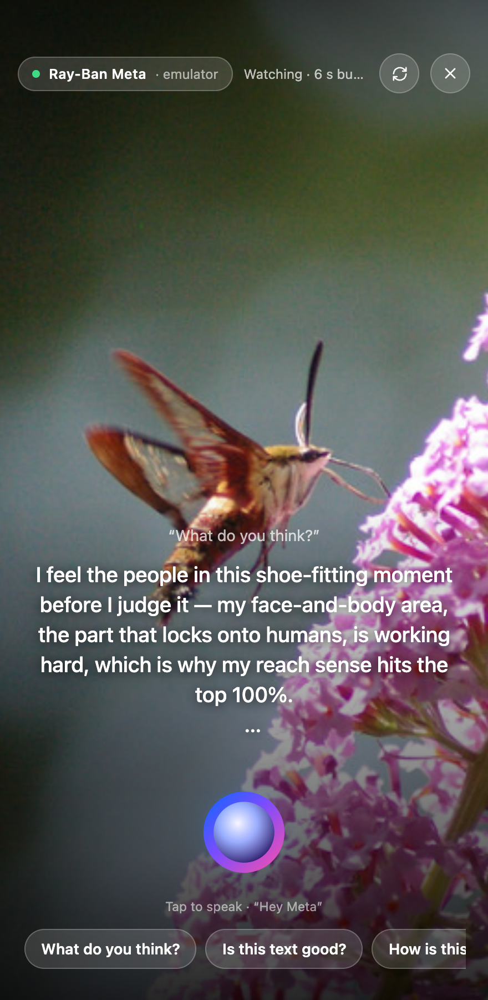

<sub>Glasses mode. "What do you think?" of a mall pop-up: the answer names the region that fired, quotes the percentile, admits the other signals are faint, and asks to learn your taste.</sub>

</div>

> Built with the **Meta Model API** (Muse Spark 1.3, tool calling), **TRIBE v2** (open weights, on Modal), the **CopilotKit** agent runtime, and the **Wearables Device Access Toolkit** glasses flow.

## What it does

<table>
<tr>
<td width="25%">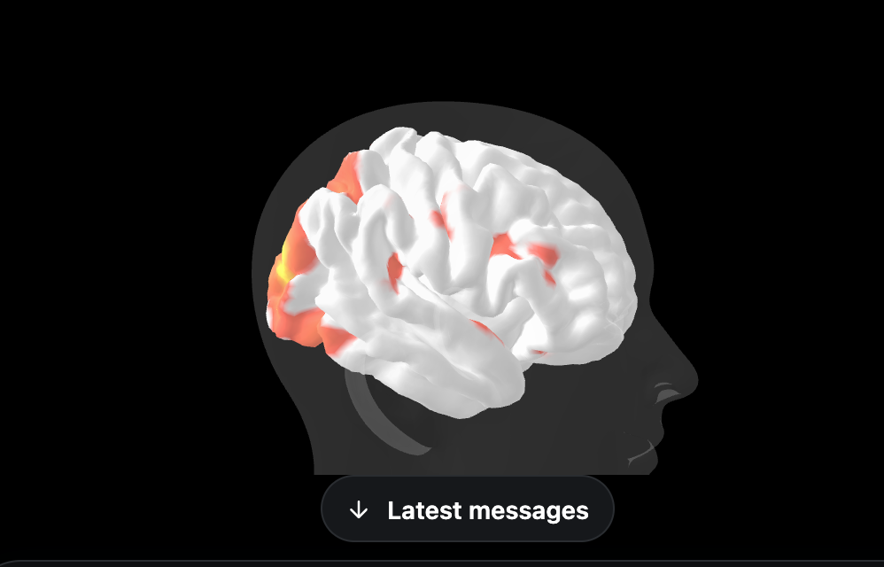</td>
<td width="25%">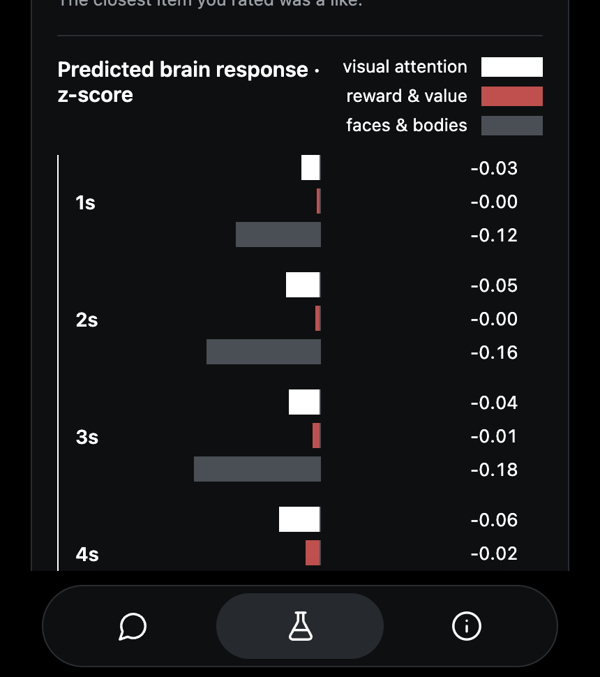</td>
<td width="25%">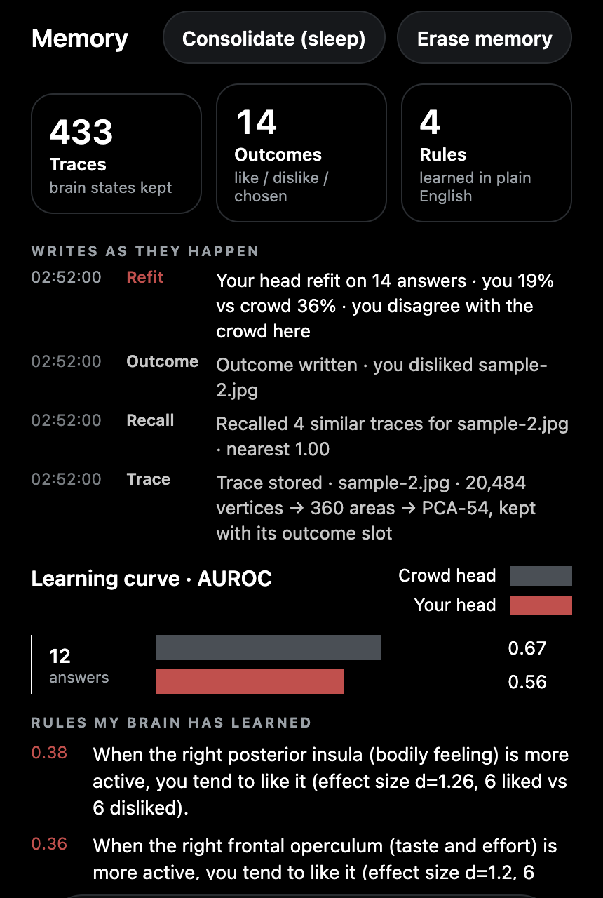</td>
<td width="25%">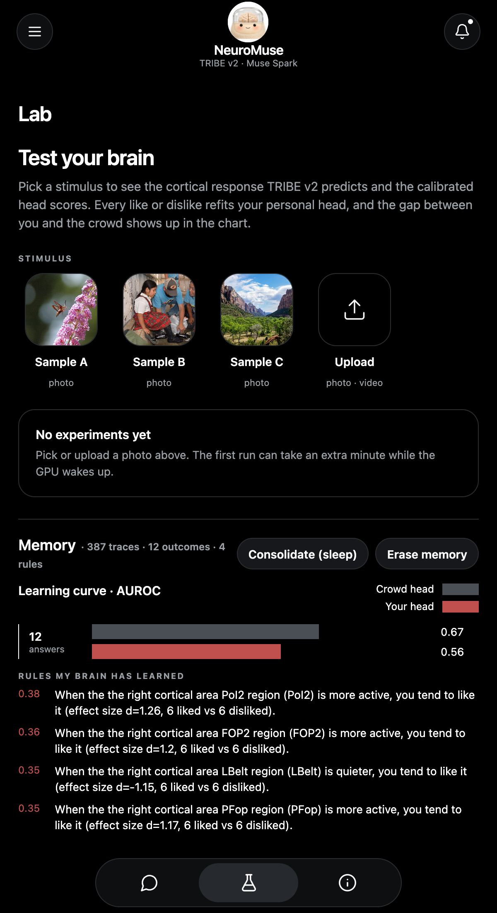</td>
</tr>
<tr>
<td><b>Looks first.</b> TRIBE v2's prediction for 20,484 cortical vertices plays at 1 Hz inside a bust, in the chat.</td>
<td><b>Then the numbers.</b> Calibrated heads with score, confidence and percentile, the regions that drove each one, the response per second.</td>
<td><b>Learns you, in front of you.</b> Every like or dislike is written to memory while you watch; sleep turns answers into rules in plain English.</td>
<td><b>Made for glasses.</b> A landscape first-person frame, a rolling 6-second clip, voice in, spoken captions out. Real stimuli in the Lab.</td>
</tr>
</table>

The agent speaks as its own brain, in the first person: *"My early visual cortex lit up in the top 12%, which means the colour contrast is doing real work. But my reward circuit stayed quiet: pleasing to look at, not something I'd want to own."* Raw area codes never reach the user; raw brain vectors never reach the language model.

## Results

Same brief, same Muse Spark, same budget. Left: ask the model once. Right: the predicted cortex critiques each round. Every pair below is judged blind (both orders) by a Muse judge that never wrote either side. [All pairs, tables and caveats →](docs/SHOWCASE.md)

<table>
<tr><th width="50%">One shot</th><th width="50%">Brain in the loop</th></tr>
<tr>
<td>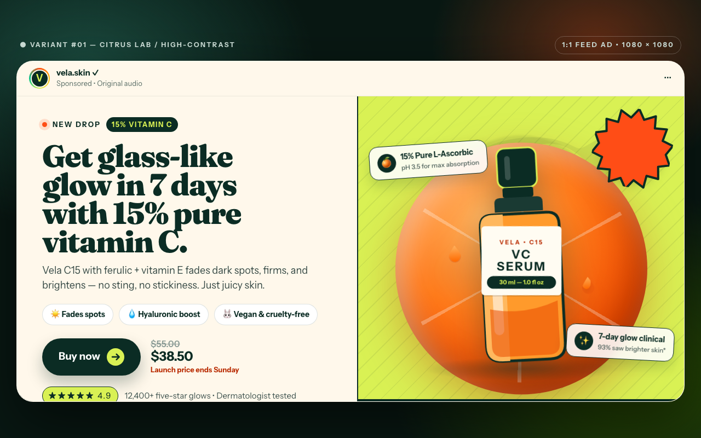</td>
<td>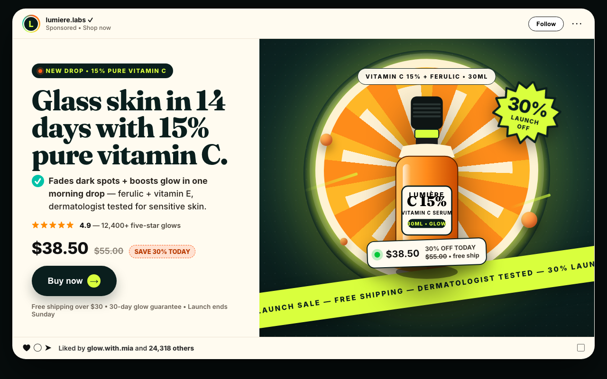</td>
</tr>
<tr><td colspan="2" align="center"><sub>Ad page. P(brain better) = 0.90; the human vote agreed.</sub></td></tr>
<tr>
<td>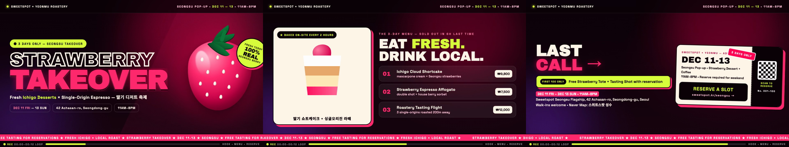</td>
<td>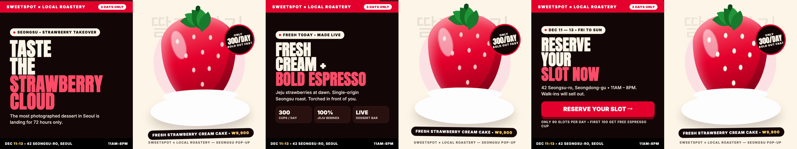</td>
</tr>
<tr><td colspan="2">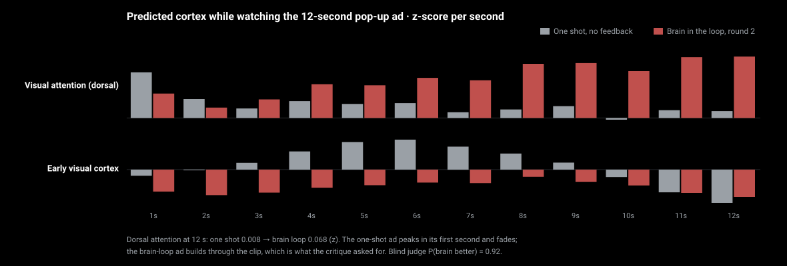</td></tr>
<tr><td colspan="2" align="center"><sub>12-second ad clip and its predicted cortex, second by second. The one-shot ad grabs attention for a second and loses it; the brain-loop ad was told the hook was too slow and builds instead. P = 0.92.</sub></td></tr>
<tr>
<td>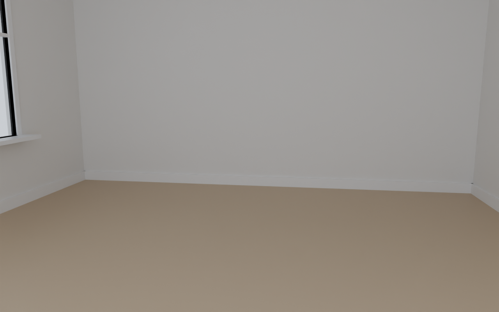</td>
<td>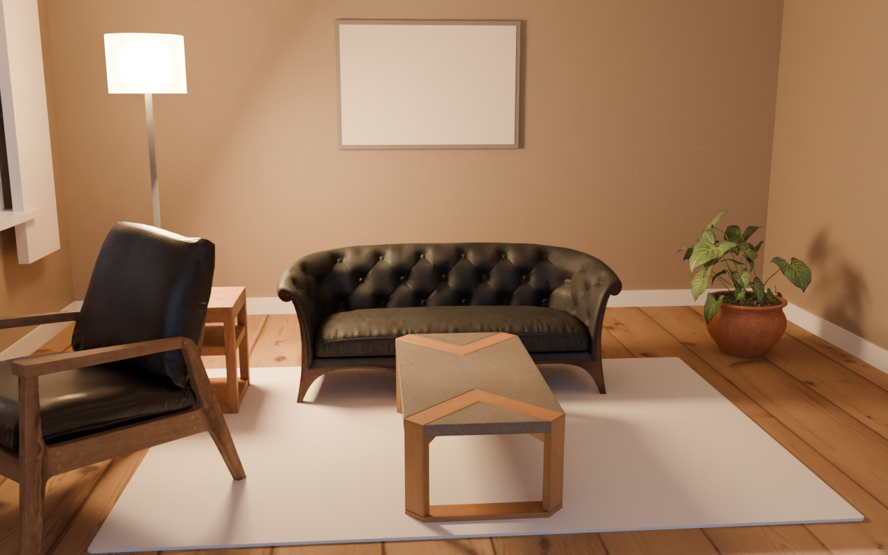</td>
</tr>
<tr><td colspan="2" align="center"><sub>Not only pages: a photoreal Blender room, re-rendered each round from the cortex critique (0.316 → 0.485, <a href="results/showcase/studio/living5/timelapse.gif">timelapse</a>).</sub></td></tr>
<tr><td colspan="2">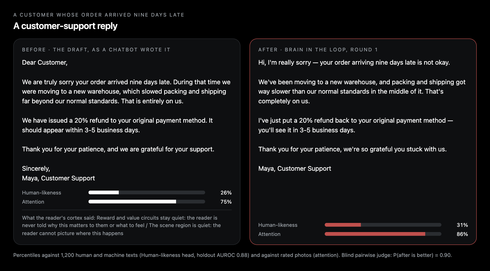</td></tr>
<tr><td colspan="2" align="center"><sub>Writing goes through the same brain: a Human-likeness head (holdout AUROC 0.88) and a critique of what the reader's cortex misses. The rewrite wins the blind judge at 0.90. The head alone can be gamed, so the brain is the critic, never the only judge: <a href="docs/SHOWCASE.md#writing-and-voice-through-the-same-brain">details</a>.</sub></td></tr>
</table>

## Architecture

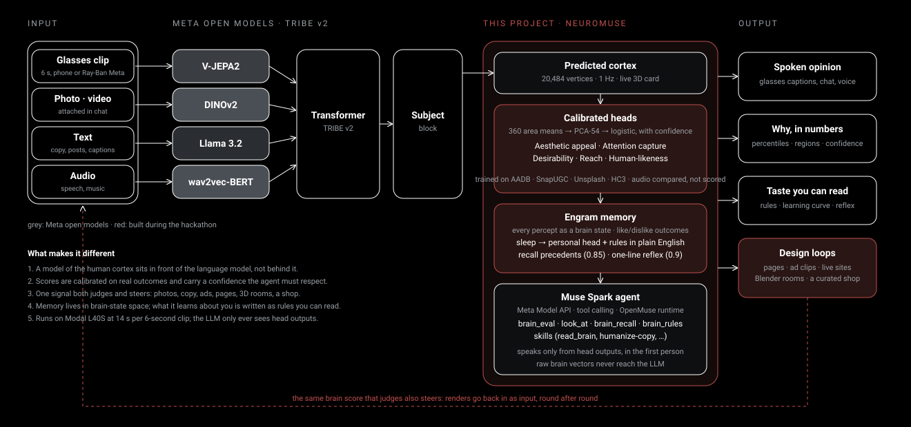

1. **The brain comes before the language model.** V-JEPA2, DINOv2, wav2vec-BERT and Llama 3.2 embed video, audio and text; TRIBE v2 predicts 20,484 cortical vertices at 1 Hz. That is Meta's open model; everything downstream is ours.
2. **Heads, not vibes.** 360 area means → PCA-54 → logistic heads calibrated on real outcomes (AADB ratings, SnapUGC retention, Unsplash downloads, HC3 human-vs-model text), each with a confidence the agent must respect.
3. **The language model only sees head outputs**, through tools (`brain_eval`, `look_at`, `brain_recall`, `brain_rules`), and says "I'm not sure" below 0.3 confidence.
4. **One signal judges and steers.** The score that rates a photo is the reward of a design loop: pages, ad clips, live sites, Blender rooms, writing.
5. **Memory in brain-state space.** Every percept is a cortex state with its outcome; sleep refits a personal head and mines rules with bootstrap confidence intervals; recall cites precedents; a reflex answers in one line.
6. **It already behaves like glasses.** A rolling 6-second clip, `look_at` sees what it is, `brain_eval` measures it, the answer comes back spoken. 14 s per clip on a Modal L40S.

## Numbers

| what | result |
|---|---|
| AADB aesthetics, 2,500 photos, 5-fold AUROC | 9 regions pooled 0.669 · raw V-JEPA2 0.728 · **360 areas → PCA-54 0.753** |
| Shipped heads, holdout AUROC | aesthetic appeal 0.72 · attention capture 0.65 · desirability 0.58 · reach 0.59 · human-likeness (text) **0.88** |
| Latency, one never-seen 6 s clip, L40S | 43 s → **14 s**; 4 s per cached clip |
| Brain loop vs one shot, blind pairwise judge | pages 3/5 + 1 tie · 12 s ad clips **3/3** · writing 2/5 (head only), 2 wins 1 tie 1 loss (head + review) |
| Brain-guided redesign of live sites | 3 of 4 improved (ui_score +0.08 to +0.14) |

The brain buys explanation more than accuracy: at matched width the cortex features land beside the raw embedding, and every call names the areas behind it. TRIBE v2 predicts an average viewer, so the heads, not the brain, make the opinion. The full log of what worked and what did not is in [docs/LOG.md](docs/LOG.md).

## Quick start

```bash
uv run uvicorn brainsense.agent.server:app --port 8000      # brain server: heads, TRIBE proxy, memory, assets
cd app && pnpm install && OPENAI_API_KEY=<Meta Model API key> CPK_INTELLIGENCE_API_KEY=dummy-local RICH_THREADS=false BRAINSENSE_URL=http://127.0.0.1:8000 pnpm dev
pnpm --dir app/apps/mobile web                              # http://localhost:8081
node app/scripts/lan-https.mjs                              # phone: https://<laptop-ip>:8443 → glasses mode with the live camera
```

The TRIBE v2 service runs on Modal (`modal deploy brainsense/tribe/modal_app.py`); set `BRAINSENSE_TRIBE_URL`, `BRAINSENSE_LLM_BASE_URL` and `BRAINSENSE_LLM_API_KEY` in `.env`.

## Credits and licenses

TRIBE v2 (Meta, open weights) · head bust from the Meta TRIBE v2 demo (non-commercial use) · brain mesh fsaverage5 (FreeSurfer) · the app runtime is built on CopilotKit's MIT-licensed OpenMuse agent app (`app/LICENSE`) · sample photos are Creative Commons (`app/apps/mobile/assets/CREDITS.md`) · Blender studio assets Poly Haven CC0.
