<div align="center">

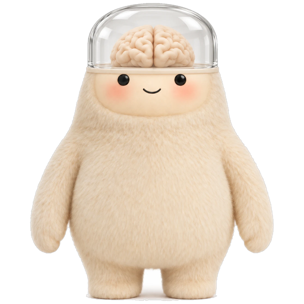

# NeuroMuse

### The Muse with a cortex.

**Ask an assistant what it thinks of your photo and it says "looks great". It never looked.**<br>
NeuroMuse looks first. Meta's TRIBE v2, a model of the human cortex, sits in front of Muse Spark, so every opinion about a photo, a clip, a line of copy or a sound comes with the brain regions and the numbers behind it, and it learns your taste as rules you can read.

[Quick start](#quick-start) · [Meet the Muse](#meet-the-muse-with-a-cortex) · [Results](#results) · [In its own words](#in-its-own-words-what-the-brain-said-step-by-step) · [Making an ad](#making-an-ad-the-loop-taken-all-the-way) · [How it is wired](#architecture-how-the-cortex-is-wired-in) · [Showcase](docs/SHOWCASE.md) · [Working log](docs/LOG.md) · [Demo storyline](docs/demo_storyline.md)

Meta Global AI Developer Hackathon 2026 · Indie track


<sub>Glasses mode, as recorded (the wait for the GPU is cut). A landscape first-person frame like the Meta glasses; the phone turns sideways and stands in for them. "What do you think?" of a mall pop-up: the answer names the regions that fired, quotes the percentiles, and says what is faint. <a href="docs/video/glasses.mp4">mp4</a></sub>

</div>

> Built with the **Meta Model API** (Muse Spark 1.3, tool calling), **TRIBE v2** (open weights, on Modal), the **CopilotKit** agent runtime, and the **Wearables Device Access Toolkit** glasses flow.

## Why a Muse needs a cortex

Ask any assistant "what do you think of this photo?" and it says "looks great". It never looked, and it cannot say why. Its taste is improvised: words about a picture, not a response to it. People who make visual decisions for a living, popup-store owners, marketers, creators, want an opinion that can say *why*, admit when it does not know, and learn what *they* like. NeuroMuse answers from a predicted human cortex instead of improvising: the response is a measurement first, words second.

Meet **Neuro**, the mascot: a fluffy Muse that keeps its cortex under a glass dome, so you can always see what it is thinking with. That is the whole idea of the project in one picture. The language model is the voice; the cortex in the dome is where the opinion comes from.

## Meet the Muse with a cortex

<table>
<tr>
<td width="50%" align="center">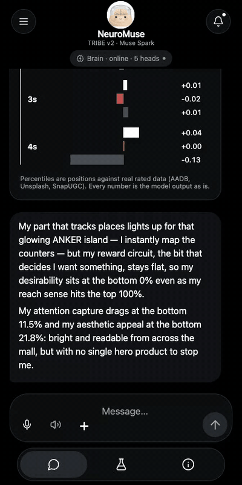</td>
<td width="50%" align="center"></td>
</tr>
<tr>
<td align="center"><sub>In the chat: attach a photo, the cortex lights up, the heads score it, the brain answers. <a href="docs/video/chat.mp4">mp4</a></sub></td>
<td align="center"><sub>In the Lab: score a stimulus, tap Like, watch memory being written and your head refit. <a href="docs/video/lab.mp4">mp4</a></sub></td>
</tr>
</table>

<table>
<tr>
<td width="25%"></td>
<td width="25%"></td>
<td width="25%"></td>
<td width="25%">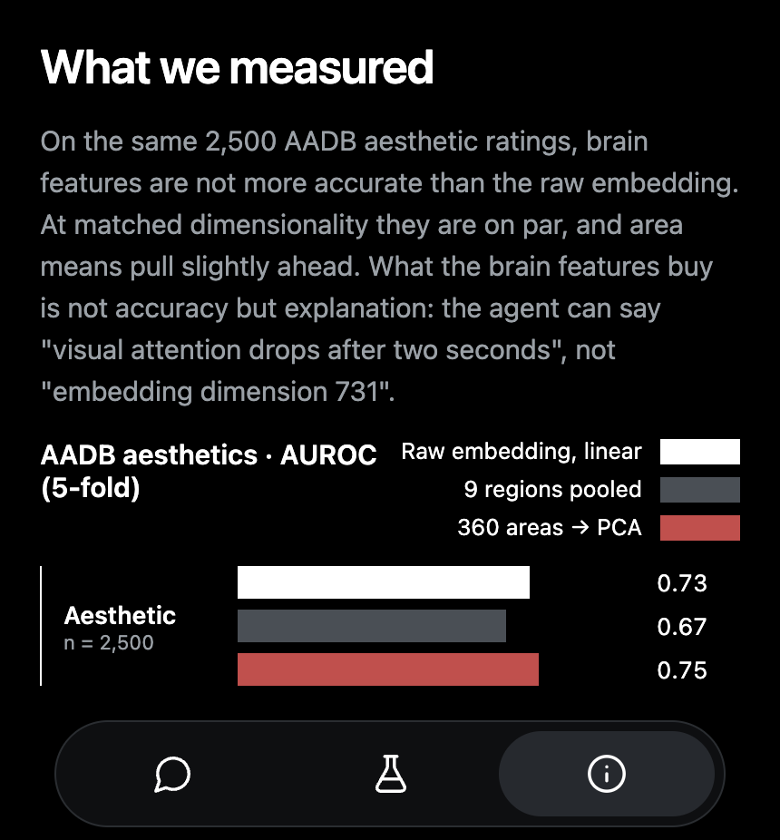</td>
</tr>
<tr>
<td><b>The brain lights up first.</b> TRIBE v2's per-vertex prediction plays on the fsaverage5 cortex inside a bust, second by second, red where the cortex responds.</td>
<td><b>Then the numbers.</b> Four calibrated heads with crowd score, confidence and percentile, the regions that drove each one, and the 1 Hz response per region.</td>
<td><b>It learns you, in front of you.</b> Every like or dislike is written to memory while you watch: trace stored, outcome written, your head refit against the crowd head. Sleep turns answers into rules in plain English; a reflex fires on anything seen before.</td>
<td><b>Honest about itself.</b> Every score carries a confidence, and the About tab shows the AUROCs and the latency we actually measured.</td>
</tr>
</table>

<table>
<tr>
<td width="72" valign="top">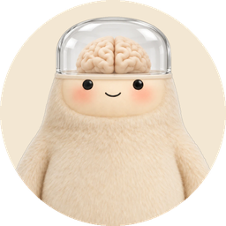</td>
<td><i>"My early visual cortex lit up in the top 12%, which means the colour contrast is doing real work. But my reward circuit stayed quiet: pleasing to look at, not something I'd want to own."</i><br><sub>Neuro speaks as its own brain, in the first person. Ask "why?" and it cites percentiles and regions in everyday words. Raw area codes never reach the user; raw brain vectors never reach the language model.</sub></td>
</tr>
</table>

## What the cortex adds

- **Looks before it speaks.** Photos, clips, text and audio go through Meta's TRIBE v2 first; the opinion is a measurement of a predicted human cortex (20,484 vertices, 1 Hz), words second.
- **Five calibrated heads, each with a confidence.** Aesthetic appeal, Attention capture, Desirability, Reach, Human-likeness (text), trained on real outcomes: AADB ratings, SnapUGC watch retention, Unsplash downloads and views, HC3 human-vs-model text. Human-likeness measures "reads like a person wrote it" (it was trained on Q&A answers), not quality: marketing copy already scores high. Audio has no labelled set, so two tracks are compared region by region, never scored. Below 0.3 confidence the agent says "I'm not sure".
- **Live 3D cortex in the chat.** The fsaverage5 surface inside a bust, the prediction playing per second, then bars, drivers and the per-region time course.
- **Glasses mode.** A landscape first-person frame like the Meta glasses: rolling 6-second clip, "Hey Meta"-style voice in, spoken captions out; a phone stands in for the glasses over HTTPS, and the Mock Device Kit path is the same flow.
- **Memory you can read.** Every percept is stored as a cortex state with its outcome (SQLite, inspectable); recall is cosine similarity in cortex space, "what have I seen that felt like this", not caption search. Sleep runs prioritized replay over the outcomes the heads got most wrong, refits a personal head, mines area-contrast rules with bootstrap confidence intervals and writes them as falsifiable English sentences into a ledger (retired, never edited); recall cites precedents above 0.85 similarity, and above 0.9 a one-line reflex answers without a reasoning pass. The Lab shows every write as it happens. Caveat: the only learning-curve numbers so far come from 12 synthetic seed outcomes (personal head 0.56 vs crowd 0.67, i.e. no personal signal yet).
- **A brain home.** The agent's workspace follows Hermes Agent's conventions: a user-editable `SOUL.md`, budgeted `MEMORY.md` and `USER.md` with a declarative-fact write gate, and skills in agentskills format whose index rides in the prompt while the body loads on demand. Five brain-reading skills are seeded; the agent can write new ones.
- **One signal judges and steers.** The same brain score is the reward of design loops: live-site redesigns, landing pages, 12-second ad clips, Blender rooms, a curated shop (36 real products ranked by the cortex), writing.
- **The brain directs the craft.** Each round an art director reads the cortex critique and picks a tool to answer it: keep and restyle a real asset, fetch and process a real photo, model the product or the room in Blender, reset the type, re-time the beats, re-flow the words. Every choice is logged and the brain narrates the trail.
- **Gates before wins.** Nothing counts as a win unless the facts are the brief's own (no invented numbers, names, dates, prices), the page keeps its density, and a blind judge prefers it. Rounds that fail are shown as failed.
- **Writing and voice through the same brain.** A Human-likeness head and a cortex critique of what the reader misses; the draft and the rewrite read aloud through the audio pathway.
- **Honest numbers.** Ablations, holdout AUROCs, latency, the judge's verdicts including the losses, all in the repo.

## Results

Only results that passed the gates are shown here: facts are the page's or the brief's own, density is kept, and a blind judge (both orders, a model that wrote neither side) prefers the result. Everything else, including every refusal and its reason, is in [docs/SHOWCASE.md](docs/SHOWCASE.md) and [docs/LOG.md](docs/LOG.md).

<table>
<tr><th width="50%">Before</th><th width="50%">After, brain-directed</th></tr>
<tr>
<td>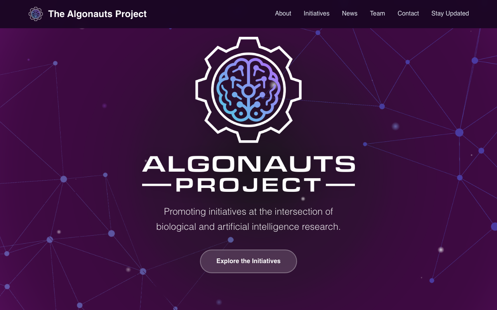</td>
<td>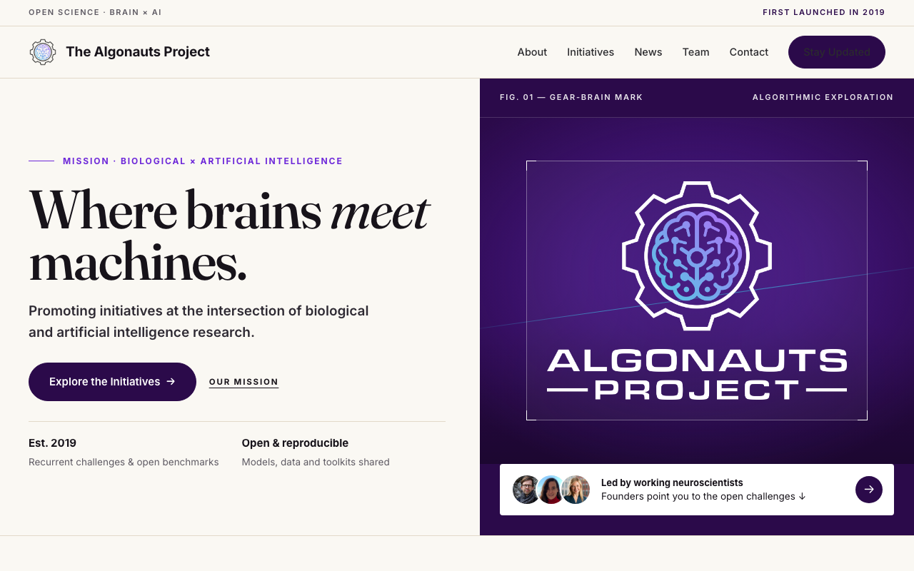</td>
</tr>
<tr><td colspan="2" align="center"><sub>A real site, evolved not replaced: the Algonauts Project. The brain said "my object sense has one logo to hold and nothing else"; the agent kept the real emblem and restyled around it, set the headline, and brought the mission, the call and the site's own portraits into the first screen. Blind judge P(after better) = 0.90, the one accepted change out of six real sites; the five iconic utility pages kept their live page. One caption ("Led by working neuroscientists") is still flagged by the claim check as a line the page never says.</sub></td></tr>
<tr>
<td></td>
<td></td>
</tr>
<tr><td colspan="2">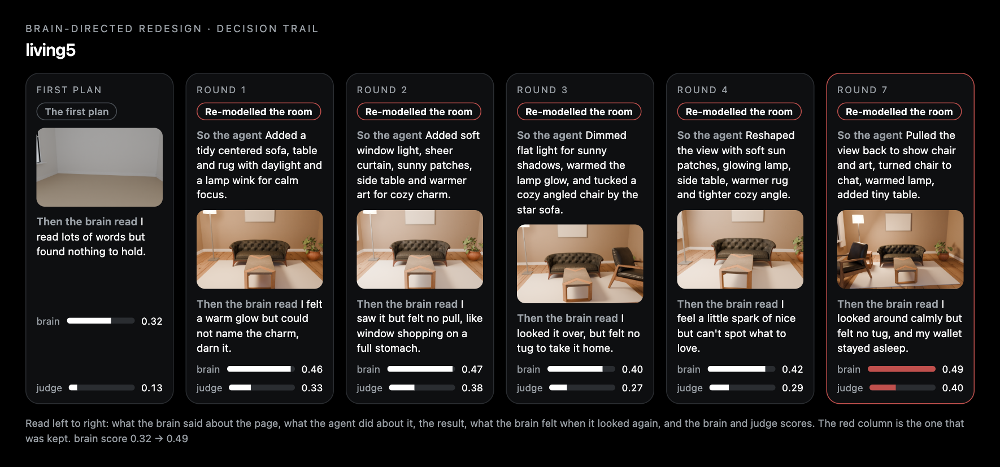</td></tr>
<tr><td colspan="2" align="center"><sub>3D, with the brain narrating. The agent models the room in Blender (Poly Haven props, Cycles); after each render the brain says what it felt ("a warm little buzz but I cannot tell what earns it", "my wallet stayed fast asleep"), and the agent answers with a concrete change. Brain score 0.32 → 0.49, judge 0.13 → 0.40 over eight rounds (<a href="results/showcase/studio/living5/timelapse.gif">timelapse</a>).</sub></td></tr>
<tr><td colspan="2"></td></tr>
<tr><td colspan="2" align="center"><sub>Writing: a Human-likeness head (holdout AUROC 0.88) and a critique of what the reader's cortex misses. The rewrite wins the blind judge at 0.90. The head alone can be gamed, so the brain is the critic, never the only judge: <a href="docs/SHOWCASE.md#writing-and-voice-through-the-same-brain">details</a>.</sub></td></tr>
</table>

The ad, from brief to finished 12-second clip with a Blender product render the brain asked for, has its own section: [Making an ad](#making-an-ad-the-loop-taken-all-the-way).

## In its own words: what the brain said, step by step

Every loop in this repo keeps a decision trail, and Neuro narrates it in its own words: what it felt, what the agent changed, and whether that helped. Sometimes the answer is "my wallet stayed fast asleep", and the round is thrown away. Read one left to right: what the brain said about the page, what the agent did about it, the result, what the brain felt when it looked again, and the two scores. The red column is the one that was kept. The narration is Muse rewriting the cortex critique in plain words; the numbers underneath are the model outputs as they are.

| | the page as it is | what the brain said | what the agent did | the kept result | brain | judge |
|---|---|---|---|---|---|---|
| Blender room (`results/showcase/studio/living5`) | an empty room, first plan | "I read lots of words but found nothing to hold" | modelled a sofa, table and rug, real sun through the window, a chair turned to face the hero | round 7 | 0.32 → **0.49** | 0.13 → **0.40** |
| Hacker News (`results/showcase/evolve/hackernews`) | the live front page | "this page made my brain sweat just to find the start" | tidied the type, enlarged the orange Y, added small icons | the live page | 0.62 vs 0.61 to 0.74 | every round rejected: fewer items than the live page, or an invented number |
| craigslist, sqlite.org, Berkshire Hathaway, Python docs (`results/showcase/evolve/*`) | live pages | "a wall of words with nothing to grab", "the scene region is quiet" | kept the real map and restyled around it; then a stylesheet-only pass that keeps the live DOM verbatim (density and facts preserved by construction) | the live pages | up to +0.2 on the brain | the blind judge preferred the live page every time (P 0.05 to 0.51): on iconic utility pages the original wins, and the harness says so |
| Algonauts Project (`results/showcase/evolve/algonauts`) | a research site's landing page | "my object sense has one logo to hold and nothing else" | kept the gear-brain emblem large, set a serif headline, put the mission and the team (the site's own portraits) in the first screen | round 1 | 0.76 → 0.74 | **P = 0.90**; one caption still flagged by the claim check |

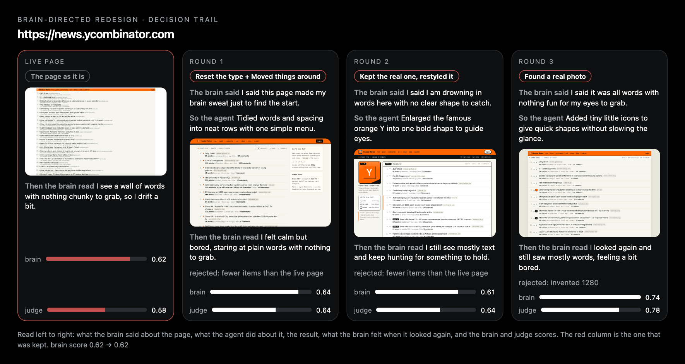

On six real sites the brain-directed loop accepted one change (Algonauts, blind P 0.90; its "Led by working neuroscientists" caption is still flagged as a claim the page never makes) and refused the rest; every refusal is logged with the judge's reason. The rows where the live page was kept are the point of the gates: a round that scores higher on the brain but drops half the stories, invents a number, or loses to the original in a blind comparison is not a win and is not shown as one. On well-known, dense utility sites that is the usual outcome; the loop's job there is to say so. The trails for every run are rendered by `brainsense/showcase/trail.py` from each `report.json`.

## Making an ad: the loop taken all the way

The same loop, end to end, on a brief for a skincare serum: *"Noon, a vitamin-C and ceramide serum in a frosted amber glass bottle, 30 ml, 20% off for the first week, for women 25 to 35 who read ingredient lists."* Muse writes a 12-second ad once (the baseline). Then, each round: the predicted cortex watches the clip at 1 Hz, the critique says what is weak and when (hook, hold, call to action), an art director picks a craft tool (model the product in Blender, re-time the beats, reset the type, re-flow the words, fetch a real photo), Muse rebuilds the clip around it, and the cortex watches again. Facts are gated against the brief; a round is kept only if it beats the best so far on brain and judge together, and the last word is a blind pairwise judge against the one-shot.

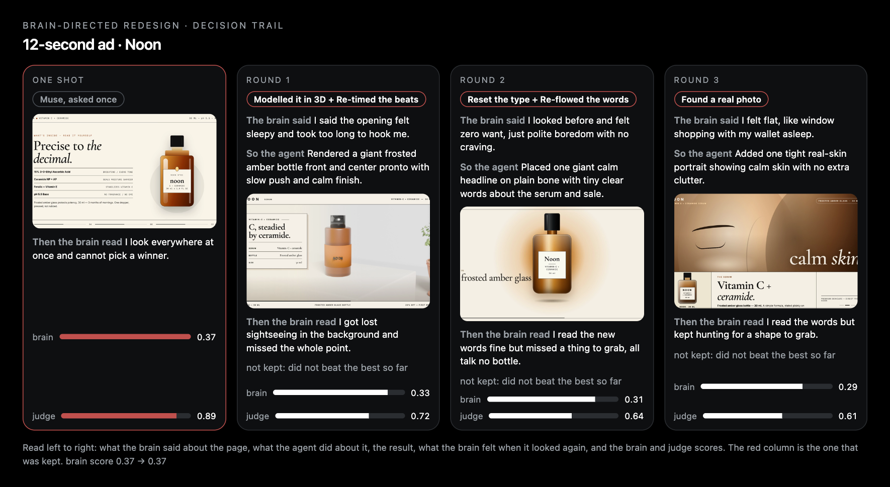

<table>
<tr>
<td width="50%">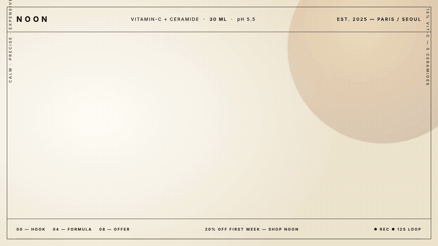</td>
<td width="50%">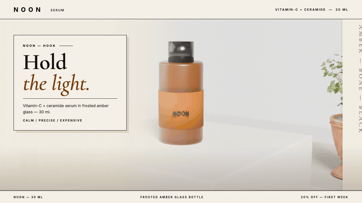</td>
</tr>
<tr>
<td><sub><b>Muse, asked once</b> (<a href="docs/video/ad-oneshot.mp4">mp4</a>). Polished, and the designer judge likes it (0.89). It also invents a pH 5.5, a price ("$68 → $54.40, save $13.60"), a discount code, 30-day returns and 48-hour shipping, none of which are in the brief. The fact gate flags the pH, the prices and the code.</sub></td>
<td><sub><b>Round 1, what the brain asked for</b> (<a href="docs/video/ad-brain.mp4">mp4</a>). "The opening felt sleepy and took too long to hook me", so the agent modelled the bottle in Blender (frosted amber glass, matte label, glossy cap) and re-timed the beats. Facts clean. The brain then said it "got lost sightseeing in the background": brain 0.33, judge 0.72, not kept.</sub></td>
</tr>
<tr>
<td colspan="2">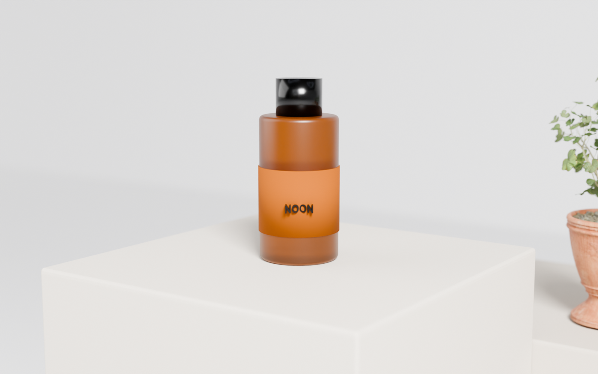</td>
</tr>
<tr><td colspan="2" align="center"><sub>The render itself: modelled, not drawn, in the brand's colours (Cycles, Poly Haven props). A product that does not exist yet gets a real object to look at instead of a stock photo of somebody else's bottle.</sub></td></tr>
<tr><td colspan="2">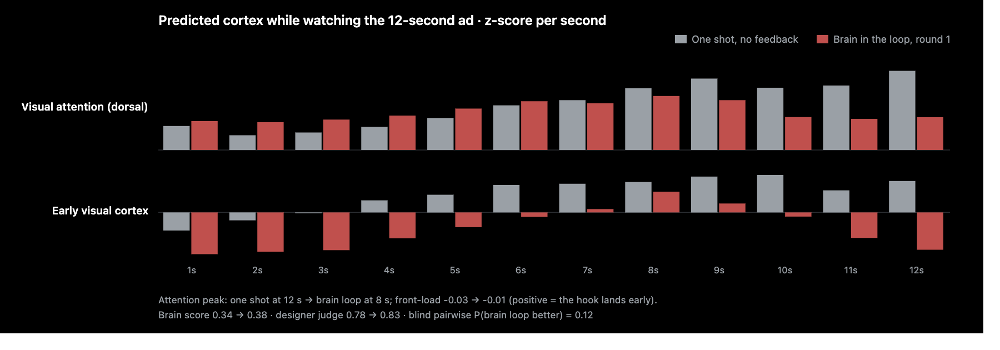</td></tr>
<tr><td colspan="2" align="center"><sub>Second by second, the thing a still can never show. Round 1 pulls the attention peak from the 12th second to the 9th, but the one-shot holds more attention overall, and the brain score says so (0.37 vs 0.33).</sub></td></tr>
</table>

| run | one shot | best brain-loop round | verdict |
|---|---|---|---|
| serum, run 1 (`results/showcase/admaker/serum-try1`) | brain 0.34 · attention peak 12 s · invents facts | round 1: brain 0.38 · peak 8 s · facts clean | kept by the loop, but the blind judge preferred the one-shot (P = 0.12) |
| serum, run 3 (`results/showcase/admaker/serum-try3`) | brain 0.38 · judge 0.89 · invents facts | round 1: the render dropped in as a small inset, brain 0.28 | one-shot kept |
| serum, run 4 (`results/showcase/admaker/serum-try4`) | brain 0.37 · judge 0.89 · invents facts | round 1: full-frame render, re-timed beats, brain 0.33, judge 0.72; rounds 2 and 3 lower | one-shot kept |

The honest result: on this brief the brain-directed loop has not yet beaten Muse's own one-shot ad. What it does show is the whole machine working end to end: the cortex reads a clip second by second, says what is wrong in plain words, picks the craft tool (here a Blender product render), rebuilds the clip without inventing a single fact, and refuses to keep a round that does not beat the baseline. The one-shot's lead is partly bought with invented specifics a fact-checked brand could not print; making the loop win without them is the next step. Code: `brainsense/showcase/admaker.py`, figures by `ad_timecourse.py` and `trail.py`.

## Use cases

<table>
<tr>
<td width="25%"><b>In a store, through the glasses.</b> Point at a shelf, ask "what do you think?", hear a grounded answer with the region that fired.</td>
<td width="25%"><b>Copy that reads human.</b> Paste a paragraph; the Human-likeness head (0.88 AUROC) and a rewrite loop turn "Our popup store offers a unique experience…" into something a person would write, with before → after percentiles.</td>
<td width="25%"><b>Ads and pages that hold attention.</b> Brain-in-the-loop generation and live-site redesign, with the 1 Hz attention course as the critique.</td>
<td width="25%"><b>Your own taste, on record.</b> Like and dislike in the Lab; read the rules it learned, watch your head overtake the crowd head, reset any time.</td>
</tr>
</table>

## Architecture: how the cortex is wired in


1. **The brain comes before the language model.** V-JEPA2, DINOv2, wav2vec-BERT and Llama 3.2 embed video, audio and text; TRIBE v2 predicts 20,484 cortical vertices at 1 Hz. That is Meta's open model; everything downstream is ours.
2. **Heads, not vibes.** 360 area means → PCA-54 → five logistic heads calibrated on real outcomes (AADB ratings, SnapUGC retention, Unsplash downloads, HC3 human-vs-model text), each with a confidence the agent must respect; audio is compared, not scored.
3. **The language model only sees head outputs**, through tools (`brain_eval`, `look_at`, `brain_recall`, `brain_rules`), and says "I'm not sure" below 0.3 confidence.
4. **One signal judges and steers.** The score that rates a photo is the reward of a design loop: pages, ad clips, live sites, Blender rooms, writing.
5. **Memory in brain-state space.** Every percept is a cortex state with its outcome; sleep refits a personal head and mines rules with bootstrap confidence intervals; recall cites precedents (cosine in cortex space, above 0.85); above 0.9 a reflex answers in one line. The workspace around it follows Hermes Agent's conventions (SOUL, MEMORY, USER, skills).
6. **It already behaves like glasses.** A rolling 6-second clip, `look_at` sees what it is, `brain_eval` measures it, the answer comes back spoken. 14 s per clip on a Modal L40S.

## Numbers, including the losses

| what | result |
|---|---|
| AADB aesthetics, 2,500 photos, 5-fold AUROC (ablation) | 9 regions pooled 0.669 · raw V-JEPA2 0.728 · 360 areas → PCA-54 0.753; the out-of-fold benchmark page on the same photos orders them the other way (raw → PCA-54 0.744, areas → PCA-54 0.715, 9 groups 0.673): at matched width the cortex features land beside the raw embedding, not above it |
| Shipped heads (five), holdout AUROC | aesthetic appeal 0.72 · attention capture 0.65 · desirability 0.58 · reach 0.59 · human-likeness (text) **0.88**; audio compared region by region, no head |
| Latency, one never-seen 6 s clip, L40S | 43 s → **14 s**; 4 s per cached clip |
| Brain loop vs one shot, blind pairwise judge (Muse) | pages 3/5 + 1 tie · 12 s ad clips **3/3** · writing 2/5 (head only), 2 wins 1 tie 1 loss (head + review) |
| Brain loop, human blind vote (16 pairs, one voter, the author) | **11/16**: 6/8 against Muse's own self-critique loop, 5/8 against one shot. By Muse's judge the self-loop wins those pages; by the human it loses them |
| Unsplash downloads per view, out-of-fold AUROC (`results/showcase/bench`) | 0.56 for every feature set, cortex or raw: popularity is not in the cortex, and the Reach head is reported with that in mind |
| Brain-guided redesign of live sites, with fact, density and blind-judge gates | six real sites: one accepted (Algonauts, blind P 0.90, while its brain-only score fell 0.59 → 0.49: the brain is the critic, the blind judge is the verdict), five iconic utility pages kept their live page. Earlier pre-gate redesigns raised ui_score but invented facts and are not counted |
| Ad maker, serum brief, three runs | the one-shot invents 5 to 8 facts per clip and is kept in all three; the brain loop moves the attention peak earlier (12 s → 8 to 9 s) with clean facts but does not beat the one-shot (blind P = 0.12 in run 1) |
| Personal head after 12 synthetic outcomes | LOO AUROC 0.56 vs crowd 0.67, i.e. no personal signal yet at n = 12 (reported as is) |
| Text pathway, Human-likeness head by domain | finance 0.91 · medicine 0.95 · open-QA 0.89 · Reddit ELI5 0.91 · Wikipedia-CS 0.75 (n = 230, ECE 0.077) |

The brain buys explanation more than accuracy: at matched width the cortex features land beside the raw embedding, and every call names the areas behind it. TRIBE v2 predicts an average viewer, so the heads, not the brain, make the opinion. The full log of what worked and what did not is in [docs/LOG.md](docs/LOG.md).

## Quick start

```bash
uv run uvicorn brainsense.agent.server:app --port 8000      # brain server: heads, TRIBE proxy, memory, assets
cd app && pnpm install && OPENAI_API_KEY=<Meta Model API key> CPK_INTELLIGENCE_API_KEY=dummy-local RICH_THREADS=false BRAINSENSE_URL=http://127.0.0.1:8000 pnpm dev
pnpm --dir app/apps/mobile web                              # http://localhost:8081
node app/scripts/lan-https.mjs                              # phone: https://<laptop-ip>:8443 → glasses mode with the live camera
```

The TRIBE v2 service runs on Modal (`modal deploy brainsense/tribe/modal_app.py`); set `BRAINSENSE_TRIBE_URL`, `BRAINSENSE_LLM_BASE_URL` and `BRAINSENSE_LLM_API_KEY` in `.env`.

## Repository layout

| path | what |
|---|---|
| `brainsense/agent/` | the brain server: heads, TRIBE proxy, Engram memory, sleep, rules, reflex, skills, `/assets` |
| `brainsense/tribe/` | the TRIBE v2 service on Modal (video, audio and text events, per-area features, per-vertex time series) |
| `brainsense/loop/`, `brainsense/showcase/` | design loops and the showcase harness: pages, ad clips, live-site redesigns, Blender studio, writing |
| `heads/`, `scripts/` | trained heads and the data → features → heads scripts |
| `app/` | the client: React Native + Expo app and the Hono agent server with the brain tools ([app/README.md](app/README.md)) |
| `results/` | every run: ablations, showcase pairs, latency, votes |
| `docs/` | [SHOWCASE.md](docs/SHOWCASE.md) (every pair with numbers), [LOG.md](docs/LOG.md) (the working log), [demo_storyline.md](docs/demo_storyline.md), figures, screenshots, videos |

## Credits and licenses

Neuro, the mascot, is the project's own character (`docs/img/neuromuse-logo.png`, also the app icon) · TRIBE v2 (Meta, open weights) · head bust from the Meta TRIBE v2 demo (non-commercial use) · brain mesh fsaverage5 (FreeSurfer) · the app runtime is built on CopilotKit's MIT-licensed OpenMuse agent app (`app/LICENSE`) · sample photos are Creative Commons (`app/apps/mobile/assets/CREDITS.md`) · Blender studio assets Poly Haven CC0.
