# NeuroMuse showcase

The long version of the README: why, what it feels like, every before/after pair with its numbers, the writing and voice runs, and the use cases. Raw outputs live under `results/showcase/`.

## Why

Ask any assistant "what do you think of this photo?" and it says "looks great". It never looked, and it cannot say why. People who make visual decisions for a living, popup-store owners, marketers, creators, want an opinion that can say *why*, admit when it does not know, and learn what *they* like. NeuroMuse answers from a predicted human cortex instead of improvising: the response is a measurement first, words second.

## What it feels like

<table>
<tr>
<td width="25%">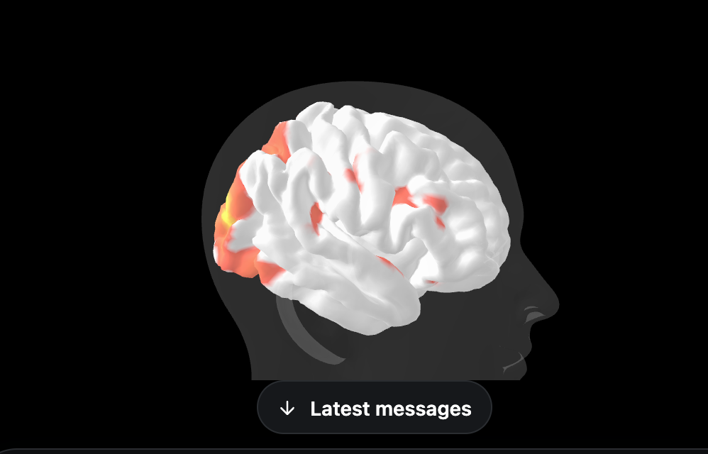</td>
<td width="25%">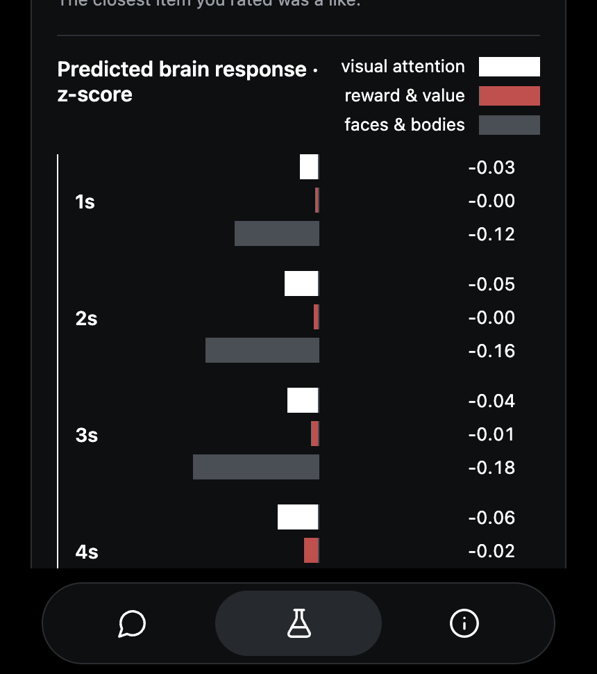</td>
<td width="25%">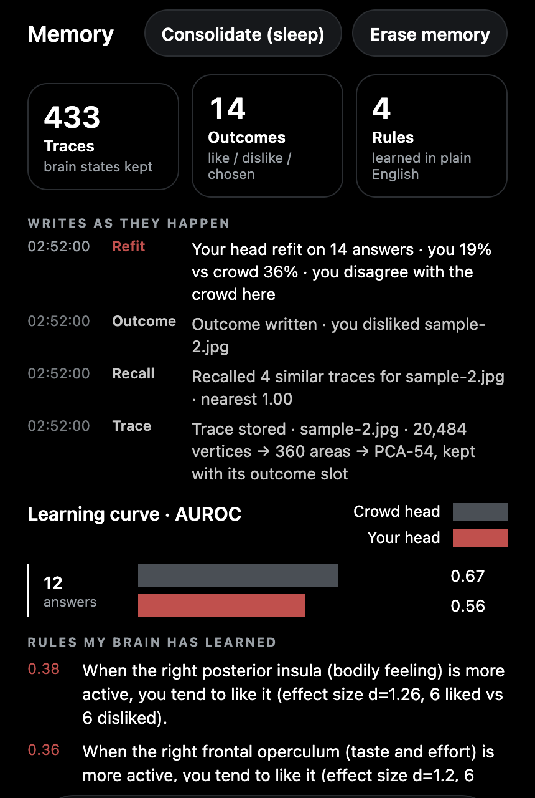</td>
<td width="25%">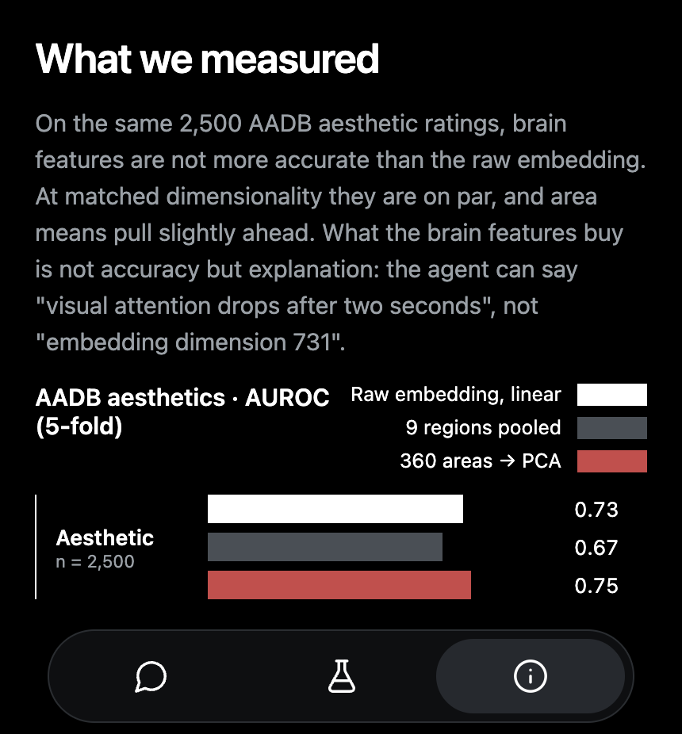</td>
</tr>
<tr>
<td><b>The brain lights up first.</b> TRIBE v2's per-vertex prediction plays on the fsaverage5 cortex inside a bust, second by second, red where the cortex responds.</td>
<td><b>Then the numbers.</b> Four calibrated heads with crowd score, confidence and percentile, the regions that drove each one, and the 1 Hz response per region.</td>
<td><b>It learns you, in front of you.</b> Every like or dislike is written to memory while you watch: trace stored, outcome written, your head refit against the crowd head. Sleep turns the answers into rules in plain English; a one-line reflex fires on anything it has seen before.</td>
<td><b>Honest about itself.</b> Every score carries a confidence, and the About tab shows the AUROCs and the latency we actually measured.</td>
</tr>
</table>

In the chat the agent speaks as its own brain, in the first person: *"My early visual cortex lit up in the top 12%, which means the colour contrast is doing real work. But my reward circuit stayed quiet: pleasing to look at, not something I'd want to own."* Ask "why?" and it cites percentiles and regions in everyday words; raw area codes never reach the user, and raw brain vectors never reach the LLM.

## Plain AI vs a brain in the loop

Same brief, same Muse Spark, same budget. Only the feedback differs: the left column asked the model once; the right column let the predicted cortex critique each round.

<table>
<tr><th width="50%">Muse Spark, one shot</th><th width="50%">Brain in the loop</th></tr>
<tr>
<td>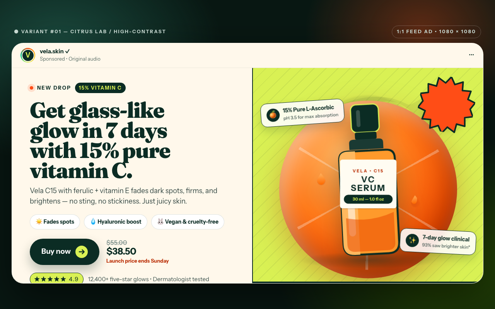</td>
<td>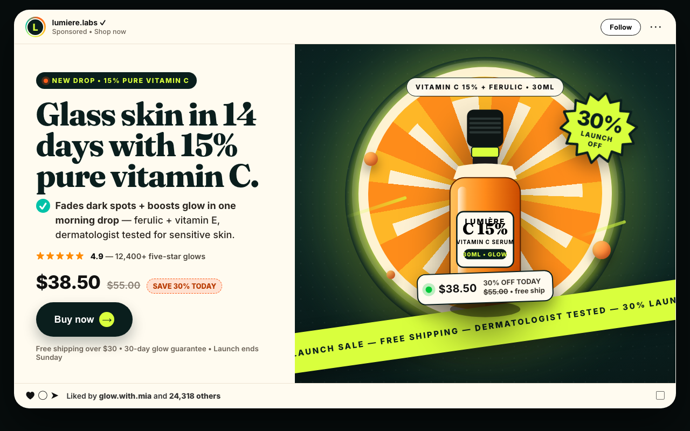</td>
</tr>
<tr><td colspan="2" align="center">Skincare ad page. Blind pairwise verdict P(brain better) = 0.90; the human vote picked the brain one too.</td></tr>
<tr>
<td>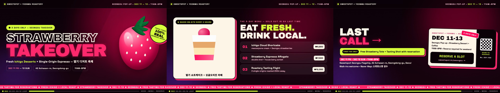</td>
<td>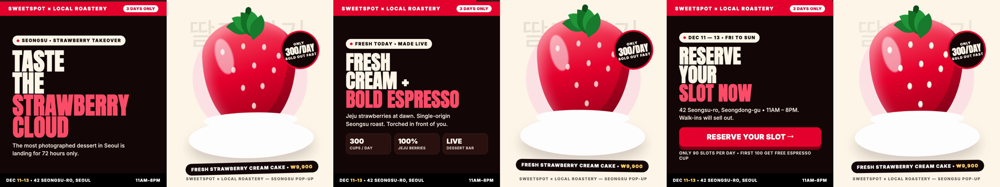</td>
</tr>
<tr><td colspan="2" align="center">12-second ad clip, frames at 1 / 5 / 9 s. On video the brain loop wins every pairwise verdict (P ≥ 0.85): the critique reads the cortex <em>time course</em> (hook, hold, call to action) that a screenshot judge never sees.</td></tr>
<tr><td colspan="2">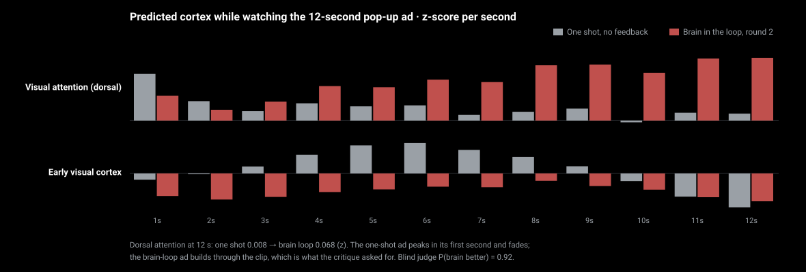</td></tr>
<tr><td colspan="2" align="center">The same two clips, second by second, in the predicted cortex. The one-shot ad grabs attention for one second and loses it; the brain-loop ad was told "the hook is too slow, hold attention after 2 s" and builds instead.</td></tr>
<tr>
<td>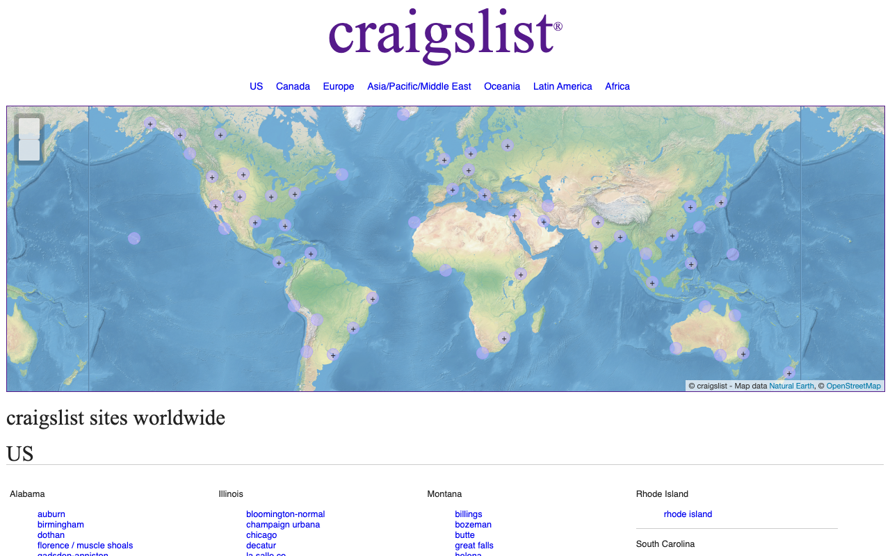</td>
<td>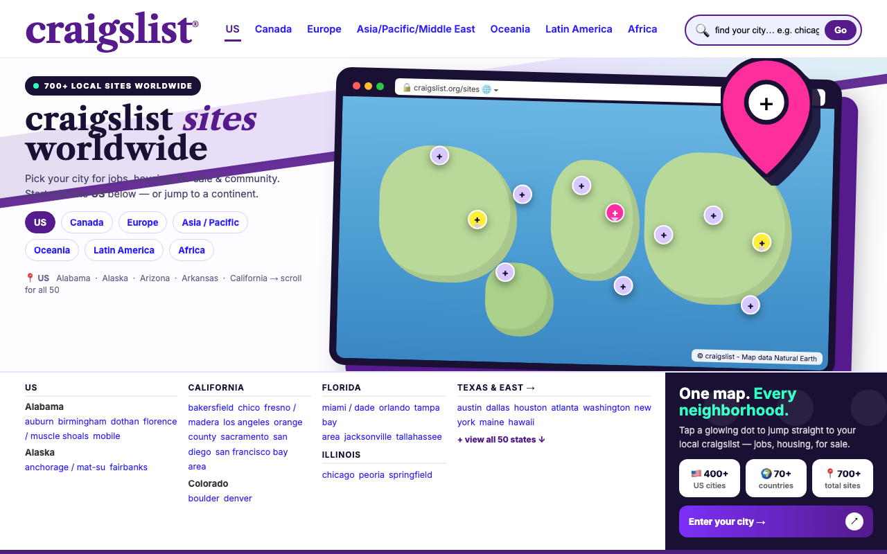</td>
</tr>
<tr><td colspan="2" align="center">A live site, brand and copy kept. The brain asked for an object silhouette and something to hold attention after two seconds; ui_score 0.473 → 0.594.</td></tr>
<tr>
<td colspan="2">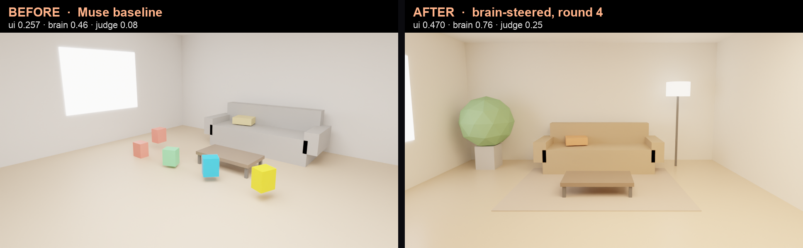</td>
</tr>
<tr><td colspan="2" align="center">Not only pages: a parametric Blender room, re-rendered each round from the cortex critique, 0.257 → 0.470 in six rounds (<a href="../results/showcase/interior/room3/timelapse.gif">timelapse</a>).</td></tr>
<tr>
<td>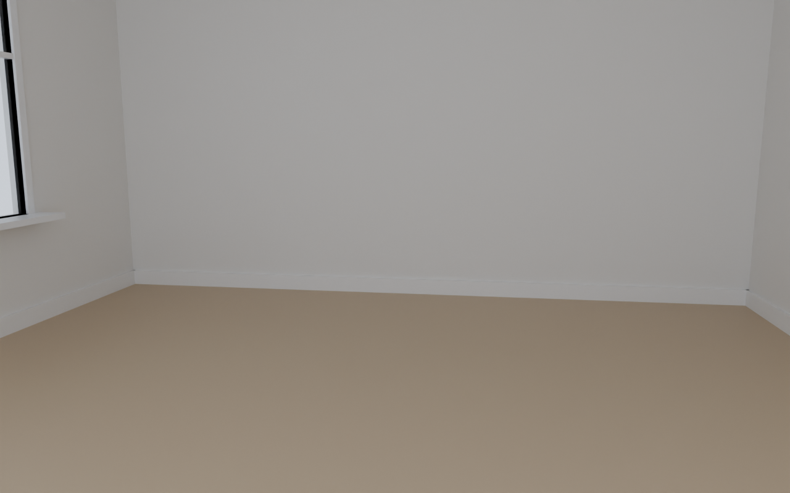</td>
<td>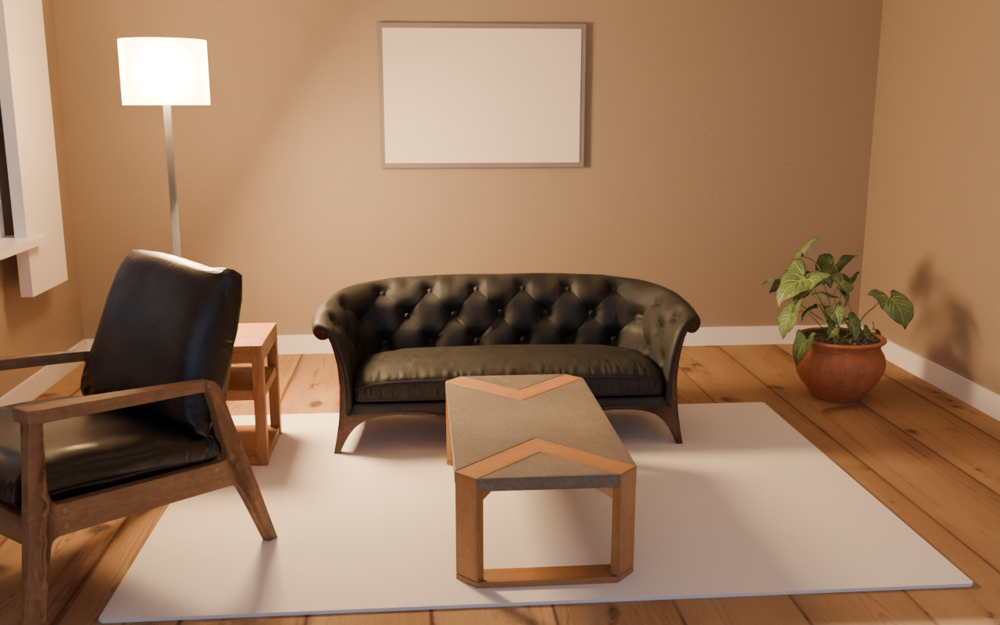</td>
</tr>
<tr><td colspan="2" align="center">The same loop in a photoreal Blender studio (Cycles, Poly Haven CC0 assets): the planner's first pass placed nothing; eight rounds later, scored by the cortex and a judge (0.316 → 0.485), it keeps the round the brain liked most (<a href="../results/showcase/studio/living5/timelapse.gif">timelapse</a>).</td></tr>
</table>

Caveat we keep next to every win rate: on static pages, against Muse's *own* self-critique loop, the brain loop loses by Muse's own judge (which that loop optimises directly). Against "ask once" it wins on pages, and on video it wins against both. Full tables and the blind human-vote page are in the showcase section below.

## Writing and voice through the same brain

A reader's cortex, predicted by TRIBE v2 while *reading*, feeds a Human-likeness head (calibrated on 1,200 human and ChatGPT answers, holdout AUROC 0.88) and a critique in plain English: which networks the text engages and what a writer would change. Same five tasks, same Muse Spark: the draft a chatbot writes, Muse asked once to "make it sound like a person", and a brain-in-the-loop rewrite that reads the cortex back between rounds. A blind pairwise judge (Muse, both orders) picks the finalist.

<table>
<tr><td>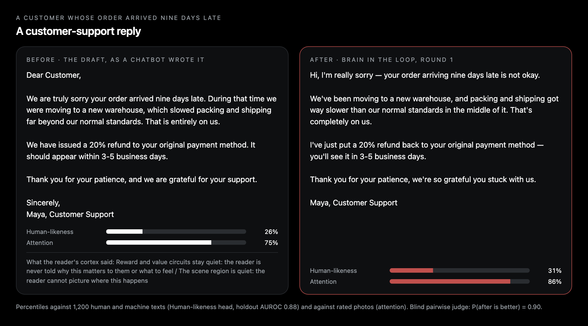</td></tr>
<tr><td>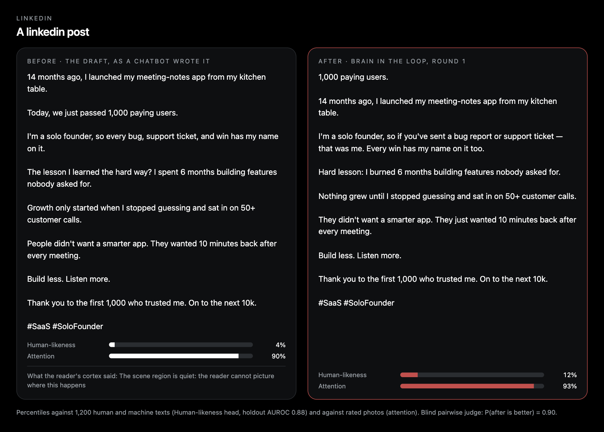</td></tr>
</table>

| task | Human-likeness pct: draft → one-shot → brain | Attention pct: draft → brain | judge P(brain > one-shot) | judge P(brain > draft) |
|---|---|---|---|---|
| customer-support reply | 26 → 4 → **31** | 75 → 86 | **0.83** | **0.90** |
| founder's LinkedIn post | 4 → 5 → **13** | 90 → 93 | **0.88** | **0.90** |
| pop-up Instagram caption | 51 → 37 → **76** | 35 → 54 | 0.12 | 0.10 |
| cold email | 8 → 4 → **14** | 86 → 77 | 0.10 | 0.12 |
| dating-app bio | 98 → 98 → 99 | 70 → 65 | 0.05 | 0.05 |

What this shows, and what it does not. The diagnosis is the strong part: a chatbot's cold email or founder post lands in the bottom 10% of the Human-likeness head, and the critique says why in words a writer can act on ("only the language regions run high: smooth sentences that touch nothing"). The loop is the weak part when it chases the head alone: on three of five tasks the head rose while the blind judge preferred the plain rewrite, because a text can score "human" by sounding hesitant and casual. A second run that selects by the head *and* Muse's own one-text review (the same brain-plus-judge blend the page harness uses, `--select blend`, `results/showcase/text/en-text2`) fixes most of that: pop-up caption 0.85 / 0.90, support reply 0.85 / 0.90, dating bio 0.53 / 0.85, cold email 0.30 / 0.50 (judge P over one-shot / over draft; the fifth task failed mid-run). So in the product the brain is the critic and never the only judge; the agent reads the diagnosis, rewrites once, and shows both scores. Voice goes through the same brain: the draft and the rewrite were read aloud by a system voice and sent through the audio pathway (16 kHz wav → wav2vec-BERT → cortex); the attention head moved with the text in three of five tasks (founder post 85 → 92), and stayed flat or fell in two. Full run: `results/showcase/text/en-text1`.

## Use cases

<table>
<tr>
<td width="25%"><b>In a store, through the glasses.</b> Point at a shelf, ask "what do you think?", hear a grounded answer with the region that fired.</td>
<td width="25%"><b>Copy that reads human.</b> Paste a paragraph; the Human-likeness head (0.88 AUROC) and a rewrite loop turn "Our popup store offers a unique experience…" into something a person would write, with before → after percentiles.</td>
<td width="25%"><b>Ads and pages that hold attention.</b> Brain-in-the-loop generation and live-site redesign, with the 1 Hz attention course as the critique.</td>
<td width="25%"><b>Your own taste, on record.</b> Like and dislike in the Lab; read the rules it learned, watch your head overtake the crowd head, reset any time.</td>
</tr>
</table>
